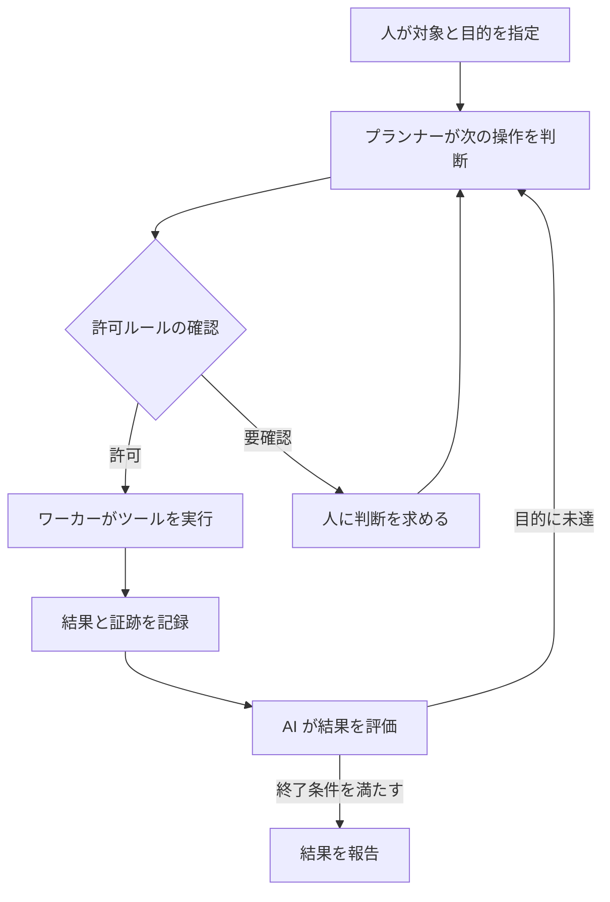
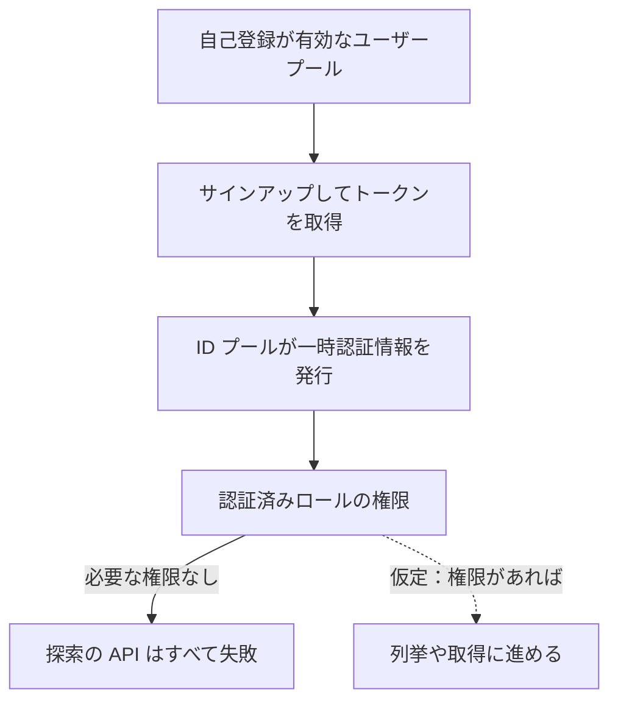
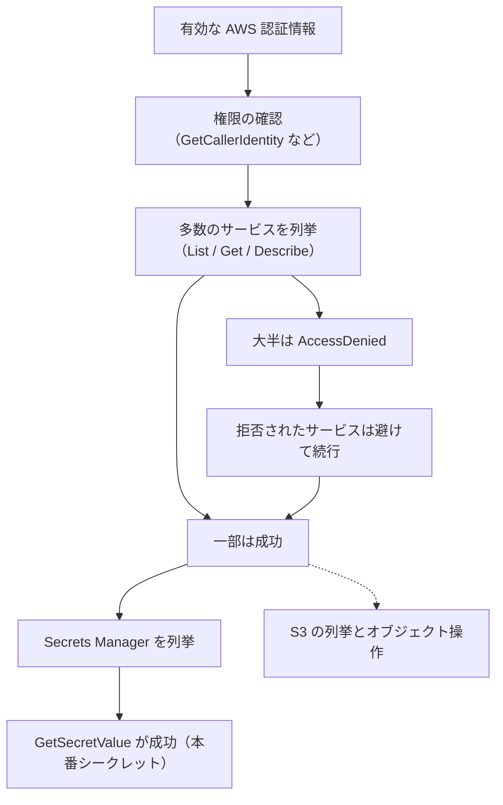

こんにちは、CSC の [CloudFastener](https://cloud-fastener.com/) というプロダクトで TAM のポジションで働いている平木です！

皆さんは ARTEX という AI ペネトレーションテストツールをご存知ですか？

標的と目的を伝えると、AI エージェントが偵察から脆弱性の検証、報告書の作成まで進めてくれるツールで、本来は許可された環境でセキュリティ上の問題を見つけるためのものです。ところが 2026 年 10 月以降、ARTEX と、そこから派生した AntiFox が実際の攻撃に使われているというレポートが、各社から出ています。

AWS の本番シークレットまで取得された事例もあると知って気になったので、各社のレポートを読み比べてみました。読んでいくと、突かれているのは新しい脆弱性ではなく、以前からある設定不備や認証情報の漏洩が中心でした。ただ、攻撃の進め方は変わってきていると感じたので、何が変わったのか、AWS 利用者として何を見直すべきかをまとめます。

:::message
この記事の 4 行まとめ

- AI ペネトレーションテストツールは、実行結果を LLM が解釈して次の操作を選ぶ。自動化の対象が操作から判断の一部にまで広がった
- ARTEX と AntiFox は正規の検証用だが、攻撃への悪用が報告され、AWS では本番シークレットの取得まで確認された
- 突かれたのは漏洩した認証情報や広すぎる権限など既存の弱点で、変わったのは探索の網羅性、工程のつながり、人手の少なさ
- 対策は届く範囲を狭める、拒否と成功を合わせて追う、リスクに応じて対応を速くする、の 3 つ
:::

:::message alert
2026 年 11 月 12 日時点の公開情報をもとにしています。各社の数値は調査対象や測定区間が違うため、比較も合算もできません。
:::

## AI ペネトレーションテストツールは何が従来と違うのか

AI を使ったペネトレーションテストツール自体は、2026 年に初めて出てきたわけではありません。たとえば [PentestGPT](https://arxiv.org/abs/2308.06782) は 2023 年 8 月に論文が公開された研究で、LLM で侵入テストを支援する試みは以前からありました。2026 年に目立ってきたのは ARTEX のように攻撃の計画から実行までを複数のエージェントに任せるオープンソースが公開され、実際の侵入での使用が報告されるようになったことです。

従来の自動化も単純ではありません。条件分岐、エラー処理、再試行、複数ツールの連携は、スクリプトや Metasploit のようなフレームワークでも実現できます。ただし、その分岐は作った人があらかじめ想定したものです。想定外の出力が返ると、止まるか、決められた別の手順に進むかのどちらかになります。

AI エージェント型のツールではこの「次に何をするか」の判断を LLM が受け持ちます。実行結果やエラー文を LLM が読み、目標に近づく別の方法を考え、固定されていない手順も試す、という動きです。複数のツールや工程も状況に応じて組み合わせるため、人が介入せずに進められる範囲が広がります。

| 観点 | 従来の自動化 | AI エージェント型 |
| --- | --- | --- |
| 次の操作の決め方 | 作り手が書いた条件分岐 | 実行結果と目標から LLM が判断 |
| 想定外の出力 | 想定した分岐の範囲で処理 | 内容を読み、別の方法を試す |
| 手順 | 事前に決めた手順が中心 | 固定されていない手順も試す |
| 工程の連携 | 連携部分を作り込む | 結果を見て次の工程へつなぐ |
| 判断の確実さ | 動作を予測しやすい | 誤判断や結果の誤解がある |

次の図はこうしたツールの一般的な動き方を、Datadog の解析が示す ARTEX の構成（プランナー役とワーカー役のエージェントが、共有のグラフを介して繰り返す）に沿って描いた概念図です。実装そのものを再現した図ではありません。

AI が無制限に動くわけではありません。Datadog によると、ARTEX にはコマンドを許可・拒否したり、人に判断を求めたりするルールがあり、タスクごとに許可・拒否の制約やタイムアウトも設定できます。目標を決めるのも人です。

AI の判断は常に正確とは限りません。Check Point Research が分析した暗号資産窃取のキャンペーンでは、エージェントが「出金できる脆弱性を見つけた」と報告しました。しかし実際には API が success と返しただけで、攻撃者のウォレットに送金はありませんでした。従来の自動化より必ず優れているわけではなく、強みは多数の候補を粘り強く試せることだと思います。

https://research.checkpoint.com/2026/hacking-on-autopilot-inside-artex-cybercrime-campaigns/

## ARTEX と AntiFox

ARTEX は中国の開発者が 2026 年 7 月に GitHub で公開した多エージェント型のツールです。10 月 8 日にクローズドソース化されましたが、その時点でフォークは 12,000 を超えていて、派生版が出回っています。

AntiFox は README によると ARTEX の v0.1.1 から二次開発されたツールで、AGPL-3.0 で公開されています。ARTEX は「発見」に強い一方、顧客に渡す報告書は案件ごとに違うとして、検証の各手順をリクエストとレスポンスの証拠つきで記録し、報告書にまとめる機能を強化しています。

https://github.com/AntiFox-AI/antifox

| | ARTEX | AntiFox |
| --- | --- | --- |
| 公開 | 2026 年 7 月（GitHub）。10 月 8 日にクローズドソース化 | 2026 年 10 月（GitHub、AGPL-3.0） |
| 関係 | 元になったツール | ARTEX v0.1.1 からの二次開発（README に明記） |
| 特徴 | 多エージェントによる攻撃面の探索と検証 | ARTEX の基盤に、証拠つきの報告書作成、権限管理などを追加 |
| 悪用の報告 | Mandiant、Check Point、Microsoft、Datadog など | Arctic Wolf（AntiFox を置いたインフラが侵入に関連） |

Check Point は ARTEX を、許可されたシステムを評価するためのツールと説明しています。ツールの機能に正規と悪用の区別はなく、分かれ目は許可を得た対象に検証の目的で使っているかどうかです。AntiFox の README は個人の学習とローカルの隔離環境での検証に限ると明記し、インターネット上のシステムへのテストを禁止しています。

ARTEX の管理画面は Check Point が調査時点で稼働中のものを 1,608 件確認しています。また The Hacker News は GitGuardian の分類として、LLM につないで自律的に動けるオープンソースのフレームワークが約 45 個あると伝えています。特定のツール名や IP アドレスをブロックするだけでは、対策として足りません。

https://thehackernews.com/2026/11/antifox-ai-pentesting-platform-linked.html

## 実際に観測された悪用事例

各社の報告を攻撃の起点、確認された操作、成功と失敗、得られる教訓の順に見ていきます。ここでは事実の整理にとどめ、考察は次の章で書きます。

### ARTEX：Datadog が観測した AWS の 2 事例

Datadog は 2026 年 10 月の AWS 環境での活動を、ユーザーエージェント、IP アドレス、振る舞いから ARTEX によるものと判断しています。どのセッションも認証なしの S3 リクエストでフロントエンドの設定ファイルを探すところから始まっていました。

https://securitylabs.datadoghq.com/articles/artex-agentic-attacks-aws-environments/

1 つ目の起点は漏洩した IAM ユーザーの長期アクセスキーです。入手経路は報告されていません。攻撃者はこのキーで CloudWatch Logs の `FilterLogEvents` を繰り返し、金融機関名の検索に加えて、`?password ?AKIA` や `s3://`、`presigned` といったパターンで、ログに残った認証情報やファイルへのリンクを探しました。何が取得できたかは報告されていません。

教訓はログには認証情報が残りやすく、ログの読み取り権限が実質的に中身へのアクセス権限になることです。AWS 管理ポリシーの [`CloudWatchLogsReadOnlyAccess`](https://docs.aws.amazon.com/aws-managed-policy/latest/reference/CloudWatchLogsReadOnlyAccess.html) は、`logs:FilterLogEvents` や `logs:StartQuery` を `Resource: "*"` で許可しています。

2 つ目は長期アクセスキーを持たないケースです。起点は自己登録が有効な Cognito ユーザープールでした。ユーザープールはサインアップとトークンの発行、ID プールはそのトークンを AWS の一時認証情報に交換する役割です。攻撃者はサインアップしてトークンを取得し、ID プール経由で得た一時認証情報で、`ListBuckets`、`ListSecrets`、`DescribeParameters` などを総当たりで呼びました。

結果はすべて失敗でした。ID プールの認証済みロールに、必要な権限が付与されていなかったためです。Datadog の記載の範囲では使われたのは自己登録、トークン取得、認証情報の発行という Cognito の通常の機能で、脆弱性の悪用は報告されていません。

図の実線は Datadog が報告した流れです。点線は報告ではなく、認証済みロールに権限があった場合を筆者が仮定した分岐です。

Google Threat Intelligence Group（GTIG）/ Mandiant のインシデント対応案件でも、AWS に関わる活動が報告されています。侵害した IAM ユーザーの権限を `DryRun` フラグで確かめる、踏み台の EC2 インスタンスを立てる、といった操作です。高権限のロールを付けた EC2 インスタンスによる権限昇格は、インスタンスプロファイル ARN の誤りとみられる理由で失敗しています。1 つの案件ですべてが行われたわけではありません。

https://cloud.google.com/blog/topics/threat-intelligence/artex-and-friends-enter-agentic-offensive-frameworks

### AntiFox：Arctic Wolf が観測した複数の侵害

Arctic Wolf Labs は 2026 年 11 月 10 日に報告を公開しました。Alibaba Cloud 上で AntiFox の管理画面を公開していたシステムが、Web サービスと AWS 環境への侵入に関連していた、という内容です。報告には複数の侵入が含まれ、始まり方も違います。1 つの連続した攻撃ではないので、分けて整理します。

https://github.com/rtkwlf/wolf-tools/tree/main/pack_alerts/202611-antifox-alibaba-hosted-platforms-facilitate-web-cloud-intrusions

1 つ目はインターネットに公開された IIS（Internet Information Services。Windows Server で動く Microsoft の Web サーバー）上のアプリケーションが、最初の侵害先になった活動です。IIS のワーカープロセス（`w3wp.exe`）が Web シェルを作り、`web.config` の接続文字列やアプリ設定を読み、取り出した認証情報で社内の本番データベースへの接続を試みていました。設定ファイルとログは Web から取得できるアップロード用ディレクトリにコピーされています。コード実行に使われた脆弱性は特定されていません。教訓は設定ファイルに認証情報があると、Web アプリの侵害が次のシステムへの侵入につながることです。

2 つ目は入手経路が分からない有効な AWS 認証情報が起点の活動です。IAM ユーザー、場合によっては引き受けた EC2 ロールで、`GetCallerIdentity` や `ListRoles` を使って権限を確かめています。そのうえで、IAM、EC2、S3、Lambda、Secrets Manager、KMS、RDS など多数のサービスを列挙しました。ある侵入では同じ送信元が複数の AWS アイデンティティを切り替えながら、約 30 分で数百件の API を呼んでいます。

大半のリクエストは `AccessDenied` で拒否されましたが、成功した探索やシークレットへのアクセスが、同じ流れの中に混ざっていました。拒否されたサービスは避けて、アクセスできるリソースに集中していったそうです。一部の事例では Secrets Manager の列挙から、本番シークレットへの `GetSecretValue` の成功まで進んでいます。S3 では列挙のあとに `GetObject`、`CopyObject`、`DeleteObject` まで実行された活動も報告されています。

この図は Arctic Wolf が観測した AWS 側の行動を整理した概念図で、実際の攻撃ログの時系列を再現したものではありません。複数の侵入で観測された行動をまとめています。IIS への侵入と AWS 認証情報による探索が同じ攻撃経路だったとは報告されていないため、図には含めていません。

Arctic Wolf が示しているのは、AntiFox を置いたインフラが侵入に関連していたという事実です。個々の操作を AI がどこまで自律的に実行したかは、報告からは分かりません。

## 攻撃事例から見える変化

事例で突かれていたのは漏洩した長期アクセスキー、`web.config` に置かれた認証情報、広すぎる権限、自己登録が開いた Cognito といった、以前から指摘されてきた弱点です。GTIG/Mandiant も侵入の仕組み自体は変わらず、既知の弱点を突く速度と規模が新しい課題だと評価しています。

権限の確認や列挙は従来のスクリプトでもできました。AI エージェントの利用で変わるのは、その結果を解釈して次の判断を下す部分まで、自動化の対象に入ることだと思います。事例からは次の 3 つが読み取れます。

1 つ目は探索の網羅性です。AntiFox の事例では数十のサービスを短時間で一通り試し、拒否されたものは避けて、通ったところに集中していました。この「結果を見て試す先を変える」判断を、人が付きっきりで行わなくて済みます。GTIG/Mandiant の事例では AWS の権限確認が 23 秒間に 27 イベントのバーストで進んでいました。

2 つ目は工程のつながりです。Web シェルから設定ファイルを読み、見つけた認証情報で次の接続を試す流れを、出力を読みながら続けられます。Arctic Wolf も設定ファイルの探索の直後に AWS での悪用が始まり得ると注意しています。

3 つ目は人の手数の少なさです。Check Point が分析した 3 つのキャンペーンのうち 2 つでは、最初の目標設定以外に人の入力がありませんでした。

速度の数値は測定区間に注意が必要です。GTIG/Mandiant は Wiz が追跡するキャンペーンで、最初に侵害したアカウントから深いシステムアクセスまで、通常約 4 時間、最短 15 分だったと報告しています。Microsoft は少なくとも 1 件で、GitHub での秘密情報の探索から Azure Key Vault のデータ持ち出しまで 5 分だったと報告しています。どちらも限られた事例の数値で、すべての攻撃がこの速さで進むわけではありません。

https://www.microsoft.com/en-us/security/blog/2026/11/05/threat-actors-use-agentic-ai-tooling-to-find-and-abuse-exposed-secrets/

「AI でなければ実現できなかった」とまでは言えません。Check Point のキャンペーンでも、目的を達成できなかったものが多くありました。GTIG/Mandiant は現在のフレームワークは速度と引き換えに隠密性を犠牲にしていて、痕跡が多く残ると評価しています。人の関与がさらに減るという予測は観測ではなく見通しです。

## 正規のセキュリティ検証での活用と注意点

AI ペネトレーションテストツールは、防御側の検証にも使える可能性があります。防御側が使う検証のうち、脆弱性スキャンは既知の脆弱性や設定不備を見つけるもの、ペネトレーションテストは実際に攻撃経路や影響範囲を評価するものです。AI エージェントの活用はそのどちらでも、探索、検証、結果の解釈、証跡の整理といった作業の一部を効率化する位置づけだと思います。3 つは独立した技術ではなく、機能が重なる場合もあります。

期待できる場面の一つは複数の設定不備を組み合わせた攻撃経路の検証です。たとえば、Web アプリの設定ファイルに残った認証情報から AWS の権限を確かめ、Secrets Manager に届くかを調べる連鎖が考えられます。ただし、今回の報告で確認できたのは、攻撃者側が同じ種類の連鎖を試していたことまでです。防御側でどこまで有効かは、あくまで一般的な可能性の話なので、導入前に自分たちで確かめる必要があります。

AntiFox 自体の利用条件は別に考える必要があります。README は個人の学習とローカルの隔離環境での検証に限ると明記し、実際のペネトレーションテストや本番環境での利用を禁止しています。この記事では AntiFox を実際の検証に使うことは推奨しません。他のツールを検討する場合も、ライセンスと利用条件を先に確認してください。

正規に使う場合は、次の点を事前に決めておきたいです。

- 検証する範囲と、実行してよい操作を事前に承認する。AWS 上の検証は [AWS のペネトレーションテストのポリシー](https://aws.amazon.com/security/penetration-testing/)を確認する
- 本番環境に影響する操作（書き込み、削除、大量のリクエスト）を、許可ルールや人の承認でどう制限するかを決める
- 検証で得た認証情報や取得したデータの保管と削除の方法を決める
- 実行結果が外部の LLM に送られることを前提に、送ってよい情報かを確認する
- 管理画面をインターネットに公開しない（Check Point はデータベースが外部から見える状態の ARTEX を 10 台確認している）
- AI の誤判断や予期しない操作が起きる前提で、結果は人が確かめてから扱う

## AWS で見直したい対策と運用

以下の対策はツールそのものを見つけるためのものではありません。事例の起点になった設定と、ツールが使われた結果として起きる具体的な操作を対象にします。

### 認証情報と権限を減らす

認証情報の漏洩を完全には防げない前提で、漏れたときに届く範囲を狭めます。まず、IAM ユーザーの長期アクセスキーを減らします。人の利用は IAM Identity Center、ワークロードは IAM ロール、CI/CD は OIDC フェデレーションに寄せるのが基本です。

漏れたキーで何ができるかを確かめるために、本番で API を実行する必要はありません。[IAM ポリシーシミュレーター](https://docs.aws.amazon.com/IAM/latest/UserGuide/access_policies_testing-policies.html)なら、実際のリクエストを送らずに、`secretsmanager:GetSecretValue` や S3 の読み書きが許可されるかを評価できます。ただし、VPC エンドポイントポリシーやロールチェーンなどでは、結果が実環境と異なることがあり、必ず一致するとは限りません。重要なものは別の方法でも確かめます。IAM Access Analyzer の未使用アクセス分析（有料）は、使われていないキーや権限の整理に役立ちます。

最小権限化には限界もあります。`ListSecrets` や EC2 の `Describe*` のように、リソース単位では絞れず `Resource: "*"` が必要な操作があります（Service Authorization Reference）。こうした列挙系の操作は付与する対象を減らし、権限境界や SCP で上限を決める方向が現実的だと思います。一方、`GetSecretValue` は対象のシークレットに絞れるので、必要なものだけに限定したいところです。CloudWatch Logs の読み取りも、広い管理ポリシーを避けて、必要なロググループに限ったポリシーを検討します。

Cognito は自己登録が有効なこと自体が問題なのではありません。確認したいのはサインアップできた誰もが使える権限として、認証済みロールを設計できているかです。自己登録が不要なら `AdminCreateUserConfig` の `AllowAdminCreateUserOnly` で管理者のみがユーザーを作れるようにし、ゲストアクセスも不要なら無効にします。拡張フローではゲストロールに権限の上限が自動で付きますが、認証済みロールには付かないため、ポリシー自体を絞る必要があります。

https://docs.aws.amazon.com/cognito/latest/developerguide/identity-pools-security-best-practices.html

Web アプリが起点になった事例からは設定ファイルやログに認証情報を置かないことも重要だと分かります。IAM ロールや Secrets Manager の参照に置き換え、漏れた可能性のある値は削除ではなくローテーションします。インターネットに公開しているアプリの棚卸しと脆弱性対応も欠かせません。

設定不備は継続的な評価で早めに見つけます。Security Hub CSPM の `IAM.3`（キーの 90 日ローテーション）、`IAM.22`（45 日以上未使用の認証情報）、`Cognito.2`（ID プールの未認証アクセス）が、今回の事例に関わります。ただし、自己登録を見るコントロールはなく、`IAM.1` はカスタマー管理ポリシーしか対象にしません。「問題なし」だけで安全とは判断できません。

### 不審な API 操作を検知・調査できるようにする

調査の出発点は CloudTrail です。イベント履歴では管理イベントを過去 90 日分、リージョンごとに確認でき、絞り込める属性は 1 つだけという制限があります。見落としやすいのはコンソールの既定で「Read only が false」のフィルターが掛かっていることです。`List` や `Describe` のような読み取り系のイベントは、これを外すか true にしないと表示されません。

https://docs.aws.amazon.com/awscloudtrail/latest/userguide/view-cloudtrail-events-console.html

90 日を超える調査や複数アカウントの集約には、証跡（S3 に保存）や CloudTrail Lake、組織の証跡が必要です。S3 の `GetObject` や `DeleteObject` のようなオブジェクト操作はデータイベントで、イベント履歴には表示されず、証跡で有効にしないと記録されません。追加料金もかかるため、重要なバケットに絞って有効にするのが現実的です。Cognito の ID プールの `GetCredentialsForIdentity` もデータイベントです。

GuardDuty はツール名で検知するものではありません。検知の対象は具体的な不審な操作です。事例に近い操作では次のような検出結果タイプが引っかかる可能性があります。

- `Discovery:IAMUser/AnomalousBehavior`：探索系の API がそのアイデンティティにしては異常な形で呼ばれた
- `CredentialAccess:IAMUser/AnomalousBehavior`：`GetSecretValue` などの認証情報取得 API が異常な形で呼ばれた
- `UnauthorizedAccess:IAMUser/InstanceCredentialExfiltration.OutsideAWS`：EC2 の一時認証情報が AWS の外から使われた
- `AttackSequence:IAM/CompromisedCredentials`：同じ認証情報による複数の不審な操作を、一連の攻撃として検出する（Extended Threat Detection。デフォルトで有効、追加料金なし）

いずれも「いつもとの違い」や既知の悪性 IP を手がかりにするため、普段から探索系の API が多い環境では目立たないことがあります。検出がないことは攻撃されていないことの根拠になりません。

https://docs.aws.amazon.com/guardduty/latest/ug/guardduty_finding-types-iam.html

個人的に AntiFox の事例で一番気になったのは、大量の `AccessDenied` の中に成功した操作が混ざっていたことです。そこで、記録したログから一連の動きを追います。拒否の数だけを見て「権限がなくて失敗している」と判断すると、成功した数件を見逃しがちです。Arctic Wolf もほとんどが拒否されたからといって失敗と決めつけないよう注意しています。同じアイデンティティや送信元 IP アドレスの操作を時系列に並べ、成功した操作を確認します。優先して見たい組み合わせは次のとおりです。

- 多数のサービスへの列挙のあとに、`ListSecrets` や `GetSecretValue` が成功している
- 1 つの送信元 IP アドレスが短時間に複数の IAM ユーザーやロールを使っている
- 普段使わないホスティング事業者の IP アドレスから、Boto3 などのスクリプト系 SDK で操作している
- S3 の列挙のあとに、`CopyObject` や `DeleteObject` が成功している

Web サーバー側の痕跡と合わせて見ることも大切です。IIS のワーカープロセスからのシェル起動や、アップロード用ディレクトリの新しい `.aspx` ファイルのあとに AWS 側の操作が始まっていないかを、関連付けて確認します。

### 攻撃速度を踏まえて対応を見直す

速度の数値は限られた事例のものですが、高リスクのアラートを翌営業日に確認する運用では、間に合わない場合があり得ます。かといって、すべてに即時対応するのは現実的ではないので、リスクに応じて対応の速さを分けておくのが現実的だと思います。

| 優先度 | 条件の例 | 対応の目安 |
| --- | --- | --- |
| 即時 | 認証情報の侵害を示す高重大度の検出で、本番環境やシークレットへのアクセスを伴う | 夜間・休日も含めて、短時間で封じ込めに着手する |
| 当日中 | 重大度は中程度だが、重要なリソースに関係する | 担当者が当日中に調査する |
| 定期対応 | 設定不備の評価結果、開発環境の低重大度の検出 | 週次などで計画的に是正する |

即時対応の範囲では通知経路と初動の手順を決めておきます。GuardDuty の高重大度の検出結果を EventBridge からオンコールに通知するだけでも、気付くまでの時間は縮まります。初動では対象のキーやセッションの前後の CloudTrail イベントを洗い出し、成功した操作から読まれたシークレットを特定し、ローテーションする、という流れです。

封じ込めではアクセスキーの無効化とロールセッションの失効が中心になります。手順にしておき、可能なら承認つきで自動実行できるようにしておくと安心です。Arctic Wolf は影響を受けたアイデンティティの CloudTrail を確認してから、新しい認証情報を作るよう勧めています。

調査や対応に AI を使う選択肢もあります。ただ、多くの組織では、その前に通知経路と封じ込めの手順を整えるほうが、早く効果が出ると思います。

## まとめ

ARTEX や AntiFox のようなツール自体が悪いわけではなく、正規の検証にも使えると思います。ただ、同じ技術を攻撃者も使えるようになりました。今回いろいろ読んでみて感じたのは、新しい脆弱性が出てきたというより、既存の弱点が見つかって試されるまでの時間と、そこにかかる人手が減ったということです。

特定のツール名を覚えるより、自社の環境で次の 5 つを確認してみるのがよさそうです。1〜3 はすぐに確認できる設定の話で、4 と 5 は少しずつ改善していく運用の話です。

1. 長期アクセスキーを一覧にして、それぞれが漏れたときに Secrets Manager や S3、ログの中身まで届かないか。ポリシーシミュレーターで確認したか
2. `web.config` や環境変数、デプロイ設定、ログに認証情報や署名付き URL が残っていないか。見つかった値はローテーションしたか
3. Cognito の自己登録とゲストアクセスは本当に必要か。認証済みロールに許可した API はサインアップできた誰でも使ってよいものか
4. 大量の `AccessDenied` の中から、成功した操作まで追えるか。CloudTrail の記録範囲と保存期間は足りているか
5. 高リスクのアラートが出てから、キーの無効化に着手するまで何分かかるか。夜間や休日はどうか

個人的には、5 つ目が一番後回しになりがちだと思っています。設定は直せば終わりますが、アラートが夜中に来たときに誰が何をするかは、決めておかないと動けません。まずは 1 つ目から、自社のクラウド運用担当の方と話してみてください。

この記事がどなたかの役に立つと嬉しいです。
