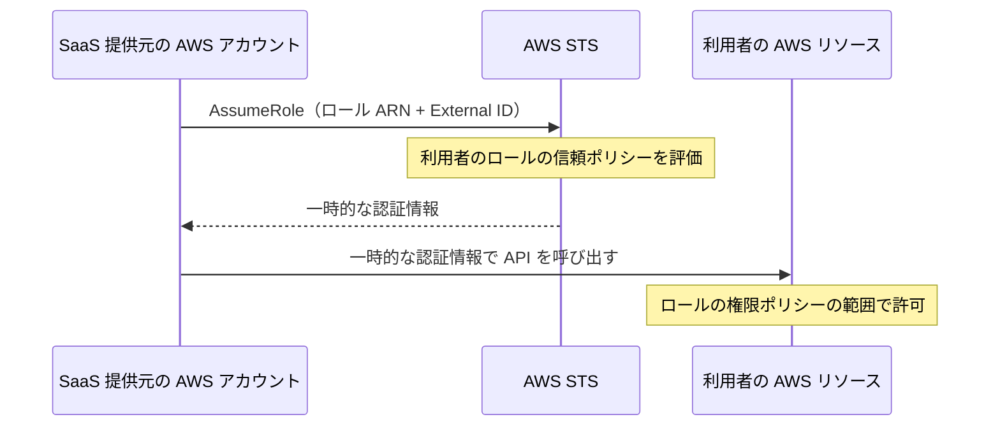

こんにちは、CSC の [CloudFastener](https://cloud-fastener.com/) というプロダクトで TAM のポジションで働いている平木です！

セキュリティ監視、データ分析、バックアップ、コスト管理など、AWS に外部 SaaS をつないでいる環境は多いと思います。連携の多くは、自社アカウントに IAM ロールを作り、SaaS 提供元の AWS アカウントにそのロールの引き受けを許可する形です。

2026 年 11 月、Wiz Research がこの仕組みが悪用された事例を公開しました。SaaS 提供元の AWS アカウントの認証情報が使われ、顧客が連携のために作ったロールが、複数の環境で引き受けられたというものです。

https://www.wiz.io/blog/qubole-cross-account-access-abused-in-the-wild

クロスアカウント IAM ロールは AWS が用意している正規の連携方式で、それ自体に問題があるわけではありません。ただ、この事例を読んで、SaaS 側の対策とは別に AWS を使う側でできることがかなりあると感じました。そこでこの記事では外部 SaaS に AWS へのアクセスを許可している立場から、普段の備えと、いざというときの動き方を考えてみます。

:::message
**この記事の 4 行まとめ**

- External ID は混乱した代理問題を防ぐための値で、SaaS 側の認証情報が悪用された場合のアクセスは防げません
- 被害の大きさは連携ロールの権限で決まるため、権限の絞り込みと不要なロールの削除が効きます
- 有事に調べられる範囲は、普段のログ設定で決まります。S3 オブジェクトの読み取りはデータイベントを有効にしないと残りません
- 封じ込めでは「新しい AssumeRole を止める」ことと「発行済みのセッションを無効にする」ことを両方行う必要があります
:::

## Wiz Research が報告した事例

Wiz Research の記事（2026 年 11 月 9 日公開）によると、2026 年 10 月 14 日から 26 日にかけて、Qubole に関連する AWS アカウントの IAM 認証情報が使われました。Qubole はデータ処理のプラットフォームです。攻撃者はこの認証情報で、顧客が Qubole との連携用に作ったクロスアカウント IAM ロールを引き受けています。認証情報がどのように取得されたかは、記事では明らかにされていません。

記事を読んで私が特に気になったのは、Wiz が攻撃者によるものと判断した AssumeRole がすべて External ID を含んでいて、すべて成功していた点です。また、引き受けられたロールの多くはほかに使われておらず、正規の通信がない状態で信頼ポリシーだけが残っていたと報告されています。

ロールを引き受けた後、攻撃者はリソースを列挙し、Lambda の環境変数、Secrets Manager、SSM Parameter Store から認証情報を集め、S3 からデータを持ち出していました。一方で、どの S3 オブジェクトが読まれたかはログがなく特定できなかった環境もあったそうです。

Wiz は、攻撃者が VPN やホスティング事業者の IP を使っていたのに対し、観測した正規の通信はすべて AWS のインフラから来ていたとも書いています。送信元の条件や監視が効いた可能性がある一方で、どの SaaS でも同じ条件が使えるわけではありません。この点は後ほど触れます。

## 外部 SaaS が AWS にアクセスする仕組み

対策を考える前に、連携の仕組みを簡単におさらいします。この記事で想定しているのは、利用者のアカウントにある IAM ロールを、SaaS 提供元の AWS アカウントが `sts:AssumeRole` で引き受ける方式です。IAM ユーザーのアクセスキーを SaaS に渡す方式は、ここでは考えません。



IAM ロールには「誰が引き受けられるか」を決める**信頼ポリシー**と、「引き受けた後に何ができるか」を決める**権限ポリシー**があります。AssumeRole が成功すると STS が一時的な認証情報を発行し、その有効期間は 15 分からロールの最大セッション時間（1〜12 時間）までです。

ここで誤解されやすいのが **External ID** です。External ID は SaaS 提供元が顧客ごとに発行する一意の値で、信頼ポリシーの `sts:ExternalId` 条件に指定します。目的は[混乱した代理問題](https://docs.aws.amazon.com/IAM/latest/UserGuide/confused-deputy.html)の防止です。たとえば別の顧客が自分の SaaS 設定にあなたのロール ARN を登録しても、SaaS はその顧客用の External ID で AssumeRole するので失敗します。

AWS は External ID を秘密情報として扱っておらず、ロールを参照できる人なら誰でも値を確認できます。つまり External ID は「SaaS がどの顧客のために動いているか」を確かめる値で、「呼び出し元が正規の SaaS の処理か」を確かめるものではありません。SaaS 側の認証情報を得た攻撃者が正しい External ID を付けて呼び出せば、AWS からは正規のリクエストと見分けがつきません。今回の事例で External ID が役に立たなかったのは、この性質によるものだと私は考えています。

## 普段からやっておきたいこと

SaaS 提供元の内部で何が起きるかは、利用者からはコントロールできません。それでも、ロールの権限、信頼ポリシーの条件、ロールの棚卸し、ログと検知は利用者側で決められます。順番に見ていきます。

### 連携ロールの権限を絞る

信頼関係が悪用されたとき、被害の大きさを決めるのはロールの権限ポリシーです。ロールが読めないものは、悪用されても読まれません。

SaaS 提供元が公開している IAM ポリシーは、すべての機能を使う前提で書かれていることがあります。自社で実際に使っている機能と照らし合わせて、特に次のような権限が本当に必要かを見直すのがおすすめです。

- `secretsmanager:GetSecretValue`、`ssm:GetParameter`、`lambda:GetFunctionConfiguration`（環境変数を返します）など、認証情報を読める権限
- `Resource: "*"` になっている S3 の読み取り権限
- 監視や分析が目的なのに含まれている書き込みや削除の権限

とはいえ、権限を削れば SaaS の機能が動かなくなることもあります。機能ごとに必要な権限を提供元に確認し、検証環境で動作を確かめてから本番に反映するのが現実的だと思います。

### 信頼ポリシーで「誰が・どこから」を絞る

次に、ロールを引き受けられる相手と条件です。Principal を `arn:aws:iam::<SaaS のアカウント ID>:root` にしていると、SaaS のアカウント内で許可されたプリンシパルなら誰でも引き受けられます。提供元が引き受けに使うロールを公開していれば、そのロール ARN まで絞れます。ただし、そのロールが SaaS 側で削除・再作成されると信頼関係が機能しなくなるので、変更時には更新が必要です。

提供元が送信元の IP 範囲を公開していれば `aws:SourceIp`、VPC エンドポイント経由で AssumeRole しているなら `aws:SourceVpce` で引き受け元を絞れます。VPC エンドポイント経由のリクエストには `aws:SourceIp` が含まれない点に注意してください。送信元が固定されていない SaaS ではこの条件は使えないので、まず提供元に確認することになります。

```json:信頼ポリシーの例（値はすべて例示用）
{
  "Version": "2012-10-17",
  "Statement": [
    {
      "Effect": "Allow",
      "Principal": { "AWS": "arn:aws:iam::<SaaS提供元のアカウントID>:role/ExampleSaaSIntegrationRole" },
      "Action": "sts:AssumeRole",
      "Condition": {
        "StringEquals": { "sts:ExternalId": "example-external-id" },
        "IpAddress": { "aws:SourceIp": ["203.0.113.0/24"] }
      }
    }
  ]
}
```

特に混同しやすいと思うのが、**信頼ポリシーの条件は AssumeRole の時点でしか評価されない**という点です。発行済みの一時的な認証情報はそれだけではどこからでも使えます。引き受け後の操作まで絞りたい場合は、権限ポリシー側に [`aws:SourceIp` を使った Deny 文](https://docs.aws.amazon.com/IAM/latest/UserGuide/reference_policies_examples_aws_deny-ip.html)を追加します。ただし、AWS サービスが代理で呼び出す場合などは[条件が期待どおりに評価されないことがある](https://docs.aws.amazon.com/IAM/latest/UserGuide/reference_policies_condition-keys.html)ので、必ず検証してから入れてください。

もう一つ知っておきたいのが、拒否されたクロスアカウントの AssumeRole は、ロール側のアカウントの CloudTrail に残らないことです。条件で防げても、試行があったこと自体は自社のログからは見えません。

Organizations を使っているなら、組織全体のガードレールも選択肢に入ります。SCP は外部から引き受けられたロールのセッションにも効くので、連携ロールに認証情報の読み取りを禁止するといった上限を設けられます。[RCP](https://docs.aws.amazon.com/organizations/latest/userguide/orgs_manage_policies_rcps.html) は STS に対応しており、組織外のプリンシパルによる AssumeRole に共通の条件を課せます。どちらも管理アカウントには適用されず、影響範囲も広いので、テスト用のアカウントや OU から少しずつ広げるのが安全です。

### 使っていない連携ロールを残さない

今回の事例で引き受けられたロールの多くは、ほかに使われていないものでした。解約した SaaS のロールを残しておくのは、使わなくなった合鍵を相手に預けたままにしておくようなものです。

棚卸しには IAM Access Analyzer が使えますが、2 種類の分析は役割がまったく違います。

| 項目 | 外部アクセス分析 | 未使用アクセス分析 |
| --- | --- | --- |
| 見ているもの | ロールの信頼ポリシーなどのリソースベースポリシー | IAM ユーザー・ロールの最終アクセス情報 |
| わかること | 信頼ゾーン（アカウントまたは組織）の外から引き受けられるロール | 指定期間（1〜365 日）使われていないロールや権限 |
| わからないこと | 実際に使われたか、その利用が正規かどうか | その利用が不正かどうか |
| 料金（執筆時点） | 追加料金なし | IAM ロール・ユーザー 1 件あたり月 0.20 USD（アナライザーごと） |

外部アクセス分析はポリシー上「外から引き受けられる」ロールを洗い出すもので、アクセスログは見ていません。承認済みの SaaS アカウントをアーカイブルールに入れておくと、想定外の信頼関係が増えたときに気付きやすくなります。

未使用アクセス分析は悪用される前に不要なロールを減らすための機能です。攻撃者に一度使われたロールは「未使用」ではなくなるので、侵害の検知には向きません。料金は対象数に比例するため、組織全体で有効にする前に一度見積もっておくと安心です。

追加料金をかけずに確認するなら、IAM コンソールや `GetRole` API でロールの最終アクティビティ（過去 400 日分）を見られます。最終利用日と SaaS の契約状況を突き合わせ、担当者に確認したうえで、ロールを削除するか、信頼ポリシーから SaaS のアカウントを外します。

### CloudTrail で後から追えるようにする

インシデントが起きたときに何を調べられるかは、普段のログ設定でほぼ決まります。連携ロールの調査で関わる主な操作を表にしておきます。

| 操作 | イベントの種類 | デフォルトで記録されるか |
| --- | --- | --- |
| `AssumeRole`、`ListBuckets`、`GetSecretValue`、`GetParameter`、`GetFunctionConfiguration` | 管理イベント | 記録される |
| S3 の `GetObject`、`HeadObject`、`ListObjects` | データイベント | 記録されない（追加料金） |

管理イベントだけでは「ロールが引き受けられ、バケット一覧が取得された」ことまではわかっても、「どのオブジェクトが読まれたか」はわかりません。機密データを置いているバケットは、データイベントか S3 サーバーアクセスログを有効にしておきたいところです。全バケットに入れるとコストがかさむので、高度なイベントセレクターで対象を絞るのがよいと思います。

CloudTrail のイベント履歴は設定なしで使えますが、管理イベントのみ、過去 90 日分、1 アカウント・1 リージョン単位という制約があります。複数のアカウントをまたいで調べるなら、全リージョンを対象にした組織の証跡でログを集め、必要に応じて CloudTrail Lake で検索できるようにしておきます。

もう一つ、CloudTrail はログを残すだけで、通知はしてくれません。気付くための仕組みは別に用意する必要があり、たとえば Amazon EventBridge が使えます。AssumeRole は読み取り専用の管理イベントなので、EventBridge のルールの状態を `ENABLED_WITH_ALL_CLOUDTRAIL_MANAGEMENT_EVENTS` にしないと拾えません（設定は AWS CLI か CloudFormation のみ）。イベントは STS を呼び出したリージョン（グローバルエンドポイントなら us-east-1）に届く点にも気を付けます。

```json:EventBridge のイベントパターン例
{
  "source": ["aws.sts"],
  "detail-type": ["AWS API Call via CloudTrail"],
  "detail": {
    "eventName": ["AssumeRole"],
    "requestParameters": { "roleArn": ["arn:aws:iam::<自社のアカウントID>:role/ExampleSaaSRole"] }
  }
}
```

拾ったイベントを見るときは、送信元 IP が SaaS の公開範囲から外れていないか、初めて見る `userIdentity.principalId` からの呼び出しではないか、普段は呼ばれない `GetSecretValue` が実行されていないか、といった点が手がかりになります。ただ、SaaS 側の構成変更で送信元が変わることもあるので、1 件のイベントだけで判断せず、普段の利用パターンと比べて判断するのがよいと思います。

### SaaS 提供元と事前に話しておく

ここまでの対策には利用者だけで決められるものと、提供元の協力が必要なものがあります。連携を始めるときや契約を更新するときに、次の点を確認しておくと、いざというときに迷わずに済みます。

| 確認しておきたいこと | 誰が対応するか |
| --- | --- |
| 機能ごとに必要な IAM 権限 | 提供元に情報をもらう |
| 引き受けに使うロール ARN、送信元 IP や VPC エンドポイントの公開 | 提供元の対応が必要 |
| External ID を再発行できるか | 提供元の対応が必要 |
| インシデント時の連絡窓口と通知方法 | 提供元と合意しておく |
| 緊急時の連携停止の手順と業務影響 | 利用者側で準備できる |
| 安全に再開するための条件 | 提供元と合意しておく |

すべての SaaS が送信元の固定や特定ロールの公開に対応しているわけではありません。対応していない場合は、権限を絞ることと監視を厚くすることで補うことになります。

## SaaS 側でインシデントが起きたときの動き方

ここからは、SaaS 提供元から侵害の連絡があったときや、連携ロールの不審な利用に気付いたときの動き方です。説明の都合で順番に書いていますが、実際には調査と封じ込めを並行して進めることが多いと思います。また、ポリシーを変更する前に、ロールの信頼ポリシーと権限ポリシーの現状を記録しておくと、調査にも復旧にも役立ちます。

### 影響を受けるロールを洗い出す

まずは、その SaaS のアカウント ID を信頼しているロールを探します。Organizations を使っているなら、管理アカウントか委任管理者アカウントで、組織を信頼ゾーンにした外部アクセス分析の検出結果を SaaS のアカウント ID で絞り込むのが早いです。SaaS は複数のアカウントに連携していることが多いので、1 アカウントだけ見て終わらせないようにします。

ロールがわかったら権限ポリシーを確認し、そのロールでどの S3 バケットやシークレットに届くのかを書き出します。これが、この後の調査範囲の上限になります。

### CloudTrail で何が行われたかを調べる

次に、AssumeRole のイベントと、引き受け後の API イベントを突き合わせて、誰がいつ何をしたのかを追います。調査で見ておきたいフィールドを表にまとめました。

| フィールド | AssumeRole のイベント | 引き受け後の API イベント |
| --- | --- | --- |
| `userIdentity.type` | `AWSAccount` | `AssumedRole` |
| `userIdentity.accountId` / `principalId` | 呼び出し元（SaaS 側）のアカウント ID とプリンシパル ID | 自社のアカウント ID と「ロール ID:セッション名」 |
| アクセスキー ID | `responseElements.credentials.accessKeyId` | `userIdentity.accessKeyId` |
| ロール | `requestParameters.roleArn` | `userIdentity.sessionContext.sessionIssuer.arn` |
| その他 | `sourceIPAddress`、`userAgent`、`roleSessionName` | `sessionContext.attributes.creationDate`（セッション発行時刻） |

あるセッションで何が行われたかを追うなら、**AssumeRole の応答に含まれるアクセスキー ID と、後続イベントの `userIdentity.accessKeyId` を突き合わせる**のが確実です。`sessionIssuer` からわかるのはどのロールが使われたかまでで、正規の SaaS のセッションと見分けるには足りません。`roleSessionName` は呼び出し元が自由に付けられる名前なので、手がかりにはなっても、それだけを信用するのは危険です。

なお、自社のログからわかる SaaS 側の情報はアカウント ID とプリンシパル ID までです。SaaS 側で誰が呼び出したのかは、提供元のログでしか確認できません。調査期間は報告された期間より前から取り、STS を呼び出したリージョンのログも漏れなく確認します。

### 不審なアクセスを止める

封じ込めの手段は 3 つあり、それぞれ止められるものが違います。ここを取り違えると、止めたつもりでアクセスが続くことになります。

| 手段 | 止められるもの | 止められないもの |
| --- | --- | --- |
| 信頼ポリシーの変更（SaaS のアカウントを外す、Deny を追加する） | 新しい AssumeRole | 発行済みのセッション |
| [セッションの無効化](https://docs.aws.amazon.com/IAM/latest/UserGuide/id_roles_use_revoke-sessions.html) | 実行時点より前に発行されたセッション | 実行後に発行された新しいセッション |
| 権限ポリシーの変更（デタッチ、Deny の追加） | 既存・新規すべてのセッションの操作 | ― |

セッションの無効化は IAM コンソールのロール画面にある `Revoke sessions` タブの `Revoke active sessions` から実行できます。実行すると `AWSRevokeOlderSessions` というインラインポリシーが追加され、`aws:TokenIssueTime` が実行時刻（伝播の遅れを考慮して約 30 秒後）より前のセッションは、すべての操作が拒否されます。実行には `iam:PutRolePolicy` 権限が必要で、サービスリンクロールには使えません。

注意したいのは、**セッションを無効にしても、新しい AssumeRole は防げない**ことです。信頼ポリシーがそのままなら、攻撃者はもう一度ロールを引き受けられます。そのため、信頼ポリシーの変更とセッションの無効化はセットで行います。逆に、シークレットをローテーションしても、発行済みのセッションが終わるわけではありません。

どの手段も正規の SaaS の処理まで止めてしまうので、業務への影響を把握したうえで、できれば提供元と連絡を取りながら進めます。同じロールが多数のアカウントにある場合は、SCP でロール名を指定して一括で Deny するのも一つの手です（管理アカウントには SCP が効かない点には注意してください）。

### どこまで影響があったかを確かめる

アクセスを止めたら、最初に書き出した「ロールで届くリソース」と、CloudTrail で確認した「実際に行われた操作」を照らし合わせます。すべてのリソースに同じ対応をするのではなく根拠のあるところから手を付けるのが現実的です。

| 対象 | 確認するイベント | 実行されていた場合の対応 |
| --- | --- | --- |
| Secrets Manager | `GetSecretValue`、`BatchGetSecretValue` | 取得されたシークレットをローテーションする |
| SSM Parameter Store | `GetParameter`、`GetParameters`、`GetParametersByPath` | 取得された SecureString の値を更新する |
| Lambda | `GetFunctionConfiguration` | 環境変数に含まれる認証情報を更新する |
| S3 | `GetObject`（データイベントまたはサーバーアクセスログ） | 読まれたデータを特定し、影響を評価する |
| IAM など | `CreateUser`、`CreateAccessKey`、`PutRolePolicy`、`UpdateAssumeRolePolicy` などの書き込み系イベント | 追加された認証情報や権限を削除する |

S3 のデータイベントが残っていなければ、どのオブジェクトが読まれたかはわかりません。その場合は、ロールが読めたバケット全体を影響範囲として考えることになります。

また、持ち出された認証情報が AWS のものとは限りません。今回の事例でも、環境内で見つかった Entra ID や Okta の認証情報が試されたと報告されています。取得されたシークレットが何に使われているかを確認し、必要に応じてそのサービスのサインインログも見ておきます。

### 安全を確認してから連携を戻す

業務で必要な SaaS を止めたままにはできないので、最終的には連携を戻すことになります。その前に、提供元から原因と対策の説明を受け、引き受けに使うプリンシパルや送信元が変わっていないかを確認します。External ID は提供元と調整して再発行し、この機会に権限と信頼ポリシーも見直しておくとよいと思います。

連携は信頼ポリシーに追加した Deny を外せば再開できます。`AWSRevokeOlderSessions` は実行時刻より前のセッションにしか効かないので、残しておいても新しいセッションには影響しません。再開してしばらくは、AssumeRole の送信元や実行される API を重点的に見ておくと安心です。

## まとめ

外部 SaaS との連携は便利で、これからも増えていくと思います。クロスアカウント IAM ロールによる連携自体が危ないわけではありません。ただ、連携先が侵害されれば、こちらが許可した信頼関係を通って自社の環境にも影響が及びます。

SaaS 提供元の中で起きることは、利用者にはどうにもできません。それでも、ロールの権限、信頼ポリシーの条件、使っていないロールの削除、ログと検知の仕組みは自分たちで決められます。そして有事には新しい引き受けを止めることと、発行済みのセッションを無効にすることを、迷わず両方実行できるようにしておくことが大切だと考えています。

今回の事例をきっかけに、自社で外部にアクセスを許可しているロールを一度見直してみてはいかがでしょうか。

この記事がどなたかの役に立つと嬉しいです。
