こんにちは、CSC の [CloudFastener](https://cloud-fastener.com/) というプロダクトで TAM のポジションで働いている平木です！

2026 年 10 月に公開された PHP の脆弱性「PHP2Shell」（CVE-2026-109618 / CVE-2026-109619）が話題になっています。こうした広く使われるソフトウェアの脆弱性が出たとき、まず知りたいのは「組織のどこに PHP が入っていて、どれが影響を受けるのか」です。

Amazon Inspector には、スキャン対象リソースの SBOM（ソフトウェア部品表）を S3 にエクスポートする機能があります。AWS のブログでも、エクスポートした SBOM を Athena でクエリする方法が紹介されています。

https://aws.amazon.com/jp/blogs/news/export-a-software-bill-of-materials-using-amazon-inspector/

この記事では PHP のバージョンや入手元を変えた EC2、ECR のコンテナイメージ、Lambda 関数を用意しました。そのうえで組織全体の SBOM を CycloneDX と SPDX の両形式でエクスポートし、Athena で PHP2Shell の影響を調べてみました。

:::message
この記事の4行まとめ
- Inspector の委任管理者アカウントから、組織全体の SBOM を S3 にエクスポートし、EC2・ECR・Lambda を Athena でまとめて調べられる
- CycloneDX と SPDX のどちらでも同じ調査はできるが、バージョンの持ち方と脆弱性情報の置き場所が違う
- Ubuntu などはパッチをバックポートするので、バージョン番号の比較ではなく、SBOM に含まれる CVE 情報で判定する
- ソースからビルドした PHP も検出できた一方、Lambda レイヤーに入っている PHP 本体は SBOM に含まれなかった
:::

## PHP2Shell とは

この章では今回調査対象にした脆弱性の概要をまとめます。

PHP2Shell は PHP 本体に見つかった 2 件の脆弱性の通称です。2 件を組み合わせると、認証なしでリモートから任意のコードを実行される恐れがあります。

| CVE | 内容 | CVSS v3.1 |
| --- | --- | --- |
| CVE-2026-109618 | メモリ不足（OOM）時のエラー処理で、未初期化のリクエストメモリが参照される | 9.8 |
| CVE-2026-109619 | リクエスト終了後もグローバル状態が解放済みメモリを参照し続ける | 8.1 |

IPA の注意喚起によると、影響を受けるバージョンと修正バージョンは次のとおりです。

| ブランチ | 影響を受けるバージョン | 修正バージョン |
| --- | --- | --- |
| PHP 8.2 | 8.2.35 より前 | 8.2.35 |
| PHP 8.3 | 8.3.36 より前 | 8.3.36 |
| PHP 8.4 | 8.4.27 より前 | 8.4.27 |
| PHP 8.5 | 8.5.12 より前 | 8.5.12 |

https://www.ipa.go.jp/security/security-alert/2026/alert20261022.html

2026 年 10 月 21 日に修正版がリリースされ、10 月 26 日には CISA の KEV（悪用が確認された脆弱性のカタログ）にも追加されました。Inspector の脆弱性データベースでも、EPSS スコアは 0.99999 と非常に高い値になっています。

:::message alert
上の表は PHP 公式（上流）のバージョンです。Amazon Linux や Ubuntu などのディストリビューションが配布する PHP パッケージは、ディストリビューション独自のバージョン番号で修正されている場合があります。この点は後半で詳しく扱います。
:::

## SBOM と CycloneDX / SPDX

この章では、SBOM とは何か、Inspector が対応する 2 つの形式に何の違いがあるかを整理します。

### SBOM とは

SBOM（Software Bill of Materials）は、ソフトウェアを構成するコンポーネントの一覧です。パッケージ名、バージョン、入手元などが機械で読める形で記録されます。

脆弱性が公表されたときに「どの資産にそのコンポーネントが含まれているか」を素早く調べられるのが、SBOM の大きな利点です。Inspector の検出結果（Findings）は脆弱性が見つかったものだけを表示します。SBOM には脆弱性の有無にかかわらず、Inspector が検出したコンポーネントが含まれます。そのため「PHP がどこに入っているか」という棚卸しにも使えます。

### CycloneDX と SPDX の違い

SBOM の代表的な形式が CycloneDX と SPDX です。Inspector は CycloneDX 1.4 と SPDX 2.3 互換の JSON をエクスポートできます。

| 項目 | CycloneDX | SPDX |
| --- | --- | --- |
| 策定団体 | OWASP | Linux Foundation |
| 標準化 | ECMA-424 | ISO/IEC 5962:2021 |
| 生まれた背景 | セキュリティ（脆弱性管理）向け | ライセンスコンプライアンス向け |
| Inspector の出力バージョン | 1.4 | 2.3 |

一般的には、脆弱性管理なら CycloneDX、ライセンス管理なら SPDX が向いていると言われます。ただし、Inspector がエクスポートする SBOM は、どちらの形式にも脆弱性情報が含まれます。

実際にエクスポートした JSON を見比べると、構造に次の違いがありました（同じ Ubuntu 24.04 インスタンスの SBOM で比較）。

| 項目 | CycloneDX 1.4 | SPDX 2.3 |
| --- | --- | --- |
| パッケージ一覧 | `components` | `packages` |
| バージョン | `version` は上流のバージョンのみ（例: `8.3.6`）。完全なバージョンは `purl`（Package URL）に入る | `versionInfo` に完全なバージョン（例: `8.3.6-0ubuntu0.24.04.13`） |
| 脆弱性情報 | トップレベルの `vulnerabilities` に CVE ID と、影響するコンポーネントの `bom-ref` | 各パッケージの `externalRefs` に `referenceCategory: SECURITY` として CVE ID |
| リソース情報 | `metadata.properties` にアカウント ID、リソースタイプ、ARN など。`metadata.component` に OS | `name` に `アカウントID/EC2/インスタンスID/AMI ID` の形式で格納 |
| ファイルサイズ | 約 310 KB | 約 710 KB |

`purl` は Package URL の略です。  
パッケージの種類・名前・バージョンなどを、`pkg:種類/名前@バージョン?追加情報` という 1 行の文字列で表す書き方です。

たとえば `pkg:dpkg/php8.3-cli@8.3.6-0ubuntu0.24.04.13?arch=AMD64` は「dpkg（Debian 系のパッケージ管理）でインストールされた `php8.3-cli` の `8.3.6-0ubuntu0.24.04.13`、アーキテクチャは AMD64」を表します。CycloneDX と SPDX のどちらでも使われています。

https://github.com/package-url/purl-spec

SPDX は `relationships` などの情報も持つため、ファイルサイズが CycloneDX の 2 倍以上になりました。Athena のスキャン量もそのぶん増えます。

:::details CycloneDX の出力例（抜粋）
```json
{
  "bomFormat": "CycloneDX",
  "specVersion": "1.4",
  "metadata": {
    "timestamp": "2026-10-28T15:39:37Z",
    "component": {
      "type": "operating-system",
      "name": "UBUNTU_24_04",
      "version": "24.04"
    },
    "properties": [
      { "name": "amazon:inspector:account_id", "value": "222222222222" },
      { "name": "amazon:inspector:resource_type", "value": "AWS_EC2_INSTANCE" },
      { "name": "amazon:inspector:instance_id", "value": "i-0123456789abcdef0" },
      { "name": "amazon:inspector:resource_arn", "value": "arn:aws:ec2:ap-northeast-1:222222222222:instance/i-0123456789abcdef0" }
    ]
  },
  "components": [
    {
      "type": "application",
      "name": "php8.3-cli",
      "purl": "pkg:dpkg/php8.3-cli@8.3.6-0ubuntu0.24.04.13?arch=AMD64&epoch=0&upstream=php8.3-cli-8.3.6-0ubuntu0.24.04.13.src.dpkg",
      "version": "8.3.6",
      "bom-ref": "..."
    },
    {
      "type": "library",
      "name": "php/php",
      "purl": "pkg:generic/php/php@8.3.6?distro=linux",
      "version": "8.3.6",
      "properties": [
        { "name": "amazon:inspector:path", "value": "/usr/bin/php8.3" }
      ],
      "bom-ref": "..."
    }
  ],
  "vulnerabilities": [
    {
      "id": "CVE-2026-89677",
      "affects": [{ "ref": "..." }]
    }
  ]
}
```
:::

:::details SPDX の出力例（抜粋）
```json
{
  "name": "222222222222/EC2/i-0123456789abcdef0/ami-0123456789abcdef0",
  "spdxVersion": "SPDX-2.3",
  "documentNamespace": "EC2://i-0123456789abcdef0",
  "creationInfo": {
    "created": "2026-10-28T16:01:12Z",
    "creators": ["Organization: 222222222222", "Tool: Amazon Inspector SBOM Generator"]
  },
  "packages": [
    {
      "name": "php8.1-cli",
      "versionInfo": "8.1.2-1ubuntu2",
      "sourceInfo": "/var/lib/dpkg/status",
      "externalRefs": [
        {
          "referenceCategory": "PACKAGE-MANAGER",
          "referenceType": "purl",
          "referenceLocator": "pkg:dpkg/php8.1-cli@8.1.2-1ubuntu2?arch=AMD64&epoch=0&upstream=php8.1-cli-8.1.2-1ubuntu2.src.dpkg"
        },
        {
          "referenceCategory": "SECURITY",
          "referenceType": "vulnerability",
          "referenceLocator": "CVE-2026-109618"
        }
      ],
      "SPDXID": "SPDXRef-Package-dpkg-php8.1-cli-..."
    }
  ],
  "relationships": [
    {
      "spdxElementId": "SPDXRef-DOCUMENT",
      "relatedSpdxElement": "SPDXRef-Package-dpkg-php8.1-cli-...",
      "relationshipType": "DESCRIBES"
    }
  ]
}
```
:::

:::message
Inspector のユーザーガイドに載っている出力例と、実際の出力ではキー名が一部異なりました。たとえば CycloneDX の `metadata.properties` は、ガイドでは `accountId` ですが、実際は `amazon:inspector:account_id` でした。テーブル定義やクエリを書く前に、実際のファイルを 1 つダウンロードして確認するのがおすすめです。
:::

また、パッケージマネージャー経由のパッケージとは別に、`php/php` というコンポーネントも記録されていました。`pkg:generic` の purl と実行ファイルのパス（`/usr/bin/php8.3`）を持っていて、Inspector が PHP の実行ファイル自体を検出しているようです。後半で紹介するように、パッケージマネージャーを使わずにソースからビルドした PHP も、この `php/php` で見つけられました。

### リソースタイプによるメタデータの違い

同じ CycloneDX でも、リソースタイプによって `metadata.properties` に入る項目が違いました。リソースを特定する項目は次のとおりです。

| リソースタイプ | リソースを特定する項目 | その他の項目 |
| --- | --- | --- |
| EC2 | `amazon:inspector:resource_arn`、`amazon:inspector:instance_id` | - |
| ECR | `amazon:inspector:repository_arn`、`amazon:inspector:image_id`（イメージダイジェスト） | `amazon:inspector:architecture` |
| Lambda | `amazon:inspector:resource_arn`、`amazon:inspector:function_name` | `amazon:inspector:runtime` |

ECR には `resource_arn` がなく、イメージタグも含まれていません。クエリではリポジトリ ARN とイメージダイジェストを組み合わせてリソースを特定します。

SPDX の `name` もリソースタイプごとに次の形式でした。

| リソースタイプ | `name` の形式 |
| --- | --- |
| EC2 | `アカウントID/EC2/インスタンスID/AMI ID` |
| ECR | `アカウントID/ECR/リポジトリARN/sha256:イメージダイジェスト` |
| Lambda | `アカウントID/Lambda/関数名/ランタイム` |

## 検証環境

この章では今回用意した環境と、EC2・ECR・Lambda それぞれの構成を説明します。

Organizations 配下で Inspector を有効化しており、委任管理者アカウントから組織全体の SBOM をエクスポートします。Inspector は EC2、ECR、Lambda（標準スキャン）のスキャンを有効にしています。

| アカウント | 役割 |
| --- | --- |
| 111111111111 | Inspector の委任管理者。S3 バケット、KMS キー、Athena を作成 |
| 222222222222 | メンバーアカウント。検証用の EC2、ECR イメージ、Lambda 関数を作成 |

### EC2

メンバーアカウントには PHP の有無・バージョン・入手元を変えた EC2 を 6 台作りました。どれも SSM Agent でマネージドインスタンスにして、Inspector のエージェントベーススキャンの対象にしています。

| Name タグ | OS | PHP のバージョン | 入手元 | PHP2Shell |
| --- | --- | --- | --- | --- |
| sbom-al2023-php84-vuln | Amazon Linux 2023 | 8.4.26-1.amzn2023.0.1 | AL2023 公式リポジトリ（修正前のバージョンを指定） | 影響あり |
| sbom-al2023-php83-fixed | Amazon Linux 2023 | 8.3.36-1.amzn2023.0.1 | AL2023 公式リポジトリ（修正版） | 修正済み |
| sbom-ubuntu2404-php83-backport | Ubuntu 24.04 | 8.3.6-0ubuntu0.24.04.13 | Ubuntu 公式リポジトリ（最新） | 修正済み（バックポート） |
| sbom-ubuntu2204-php81-old | Ubuntu 22.04 | 8.1.2-1ubuntu2 | Ubuntu 公式リポジトリ（リリース時点のバージョンに戻す） | 影響あり |
| sbom-ubuntu2404-php85-ppa | Ubuntu 24.04 | 8.5.12 | サードパーティの PPA（ondrej/php） | 修正済み（SBOM には未反映。後述） |
| sbom-al2023-nophp | Amazon Linux 2023 | なし | - | 対象外 |

Ubuntu 公式リポジトリの PHP は、上流のバージョンだけを見ると 8.3.6 や 8.1.2 と古く見えます。しかし changelog を見ると、上流の修正をバックポートしたことが記録されていました。

```text
php8.3 (8.3.6-0ubuntu0.24.04.13) noble-security; urgency=medium

  * SECURITY UPDATE: Remote RCE via state corruption issue
    - debian/patches/CVE-2026-109618_109619.patch: Avoid state corruption via
      bailout in ...
```

一方、Amazon Linux 2023 は上流のバージョンに追従する形で、`8.4.27` や `8.3.36` のパッケージが修正版として配布されています。

:::message
最初は t3.micro（メモリ 1 GB）で Amazon Linux 2023 を起動しました。すると `dnf install` と、組織で配布している SSM の関連付け（Patch Manager、Inspector や GuardDuty のプラグイン導入）が同時に動いてメモリ不足になりました。dnf が OOM Killer に止められ、Inspector のプラグイン導入も「処理中」のまま止まってしまいました。検証環境でも t3.small 以上にしておくと安心です。
:::

### ECR のコンテナイメージ

ECR には PHP の入れ方を変えたイメージを 5 つ push しました。ECR は拡張スキャン（継続スキャン）を有効にしています。

| イメージタグ | ベースイメージ | PHP の入れ方 | PHP のバージョン | PHP2Shell |
| --- | --- | --- | --- | --- |
| official-8.4.26-app | `php:8.4.26-cli-bookworm` | 公式イメージ（ソースからビルド） | 8.4.26 | 影響あり |
| official-8.4.27 | `php:8.4.27-cli-bookworm` | 公式イメージ（ソースからビルド） | 8.4.27 | 修正済み |
| debian12-apt-php | `debian:bookworm-slim` | `apt-get install php8.2-cli` | 8.2.35-1~deb12u1 | 修正済み |
| alpine-php84 | `alpine:3.22` | `apk add php84` | 8.4.27-r0 | 修正済み |
| lambda-al2023-php84 | `public.ecr.aws/lambda/provided:al2023` | `dnf install php8.4-cli`（修正前のバージョンを指定） | 8.4.26-1.amzn2023.0.1 | 影響あり |

Docker Hub の公式 PHP イメージは、PHP をソースからビルドして `/usr/local/bin/php` に置いています。dpkg などのパッケージマネージャーの管理外なので、Inspector がこれを検出できるかを確かめたくて用意しました。

`official-8.4.26-app` には、PHP ライブラリの検出も確かめるため、Composer で古い `guzzlehttp/guzzle` 7.4.0 を入れたアプリ（`/app`）を同梱しています。`lambda-al2023-php84` は、後述するコンテナイメージの Lambda 関数で使うイメージです。

:::message
最近の Composer は、既知の脆弱性があるバージョンのインストールを既定でブロックします。検証のために、`composer.json` の `config.audit.block-insecure` を `false` にして古い guzzle を入れています。
:::

### Lambda 関数

Lambda には PHP のマネージドランタイムがないので、PHP を使う代表的な 2 つの方法で関数を作りました。

| 関数名 | パッケージタイプ | ランタイム | PHP の入れ方 | PHP のバージョン |
| --- | --- | --- | --- | --- |
| sbom-php-bref-layer | zip | `provided.al2` | [Bref](https://bref.sh/) の PHP 8.4 レイヤー（`php-84:25`） | 8.4.7 |
| sbom-php-container-image | コンテナイメージ | - | 上の `lambda-al2023-php84` イメージ | 8.4.26 |

Bref は Lambda で PHP を動かすためのランタイムをレイヤーとして提供しているオープンソースのプロジェクトです。今回使ったレイヤーのバージョンは 2025 年 5 月に作られたもので、中の PHP は 8.4.7 でした。PHP2Shell の修正前のバージョンなので、古いレイヤーを使い続けている関数を想定しています。Bref 自体の問題ではなく、関数に指定したレイヤーのバージョンが古いままになっている状況を再現したものです。zip には `official-8.4.26-app` と同じ Composer の依存（guzzle 7.4.0 を含む）を入れています。

どちらの関数も `PHP_VERSION` を返すようにして呼び出し、実際に動く PHP のバージョンを確認しました。

```text
sbom-php-bref-layer       -> {"php_version":"8.4.7"}
sbom-php-container-image  -> {"php_version":"8.4.26"}
```

:::message
Bref の `php-84:25` レイヤーは `provided.al2` 向けにビルドされています。最初に `provided.al2023` で作ったところ、`Runtime.ExitError`（exit status 127）で起動しなかったので、`provided.al2` に変更しました。
:::

## SBOM をエクスポートする

この章ではエクスポート先の S3 バケットと KMS キーを用意し、組織全体の SBOM をエクスポートするまでを説明します。作業はすべて委任管理者アカウントで実施します。

### S3 バケットと KMS キーを用意する

エクスポートには、Inspector が書き込める S3 バケットと、暗号化に使うカスタマー管理の KMS キーが必要です。どちらも Inspector と同じリージョンに作ります。

S3 バケットのポリシーで、Inspector のサービスプリンシパルに書き込みを許可します。

```json
{
  "Version": "2012-10-17",
  "Statement": [
    {
      "Sid": "allow-inspector",
      "Effect": "Allow",
      "Principal": { "Service": "inspector2.amazonaws.com" },
      "Action": ["s3:PutObject", "s3:PutObjectAcl", "s3:AbortMultipartUpload"],
      "Resource": "arn:aws:s3:::inspector-sbom-export-111111111111/*",
      "Condition": {
        "StringEquals": { "aws:SourceAccount": "111111111111" },
        "ArnLike": { "aws:SourceArn": "arn:aws:inspector2:ap-northeast-1:111111111111:report/*" }
      }
    }
  ]
}
```

KMS キーのキーポリシーには、Inspector がキーを使えるようにするステートメントを追加します。

```json
{
  "Sid": "AllowInspectorToUseTheKey",
  "Effect": "Allow",
  "Principal": { "Service": "inspector2.amazonaws.com" },
  "Action": ["kms:Decrypt", "kms:GenerateDataKey*"],
  "Resource": "*",
  "Condition": {
    "StringEquals": { "aws:SourceAccount": "111111111111" },
    "ArnLike": { "aws:SourceArn": "arn:aws:inspector2:ap-northeast-1:111111111111:report/*" }
  }
}
```

`aws:SourceAccount` と `aws:SourceArn` の条件は、Inspector が他のアカウントのために書き込む「混乱した代理」問題を防ぐためのものです。メンバーアカウントの SBOM も委任管理者アカウントのレポートとして出力されるので、条件には委任管理者のアカウント ID だけを書けば大丈夫です。

### 組織全体の SBOM をエクスポートする

コンソールでは Inspector の左メニューの「SBOMs」を開き、「SBOM をエクスポート」の画面から実行できます。フィルターを指定しなければ、委任管理者の場合は組織内のスキャン対象リソースすべてが対象になります。

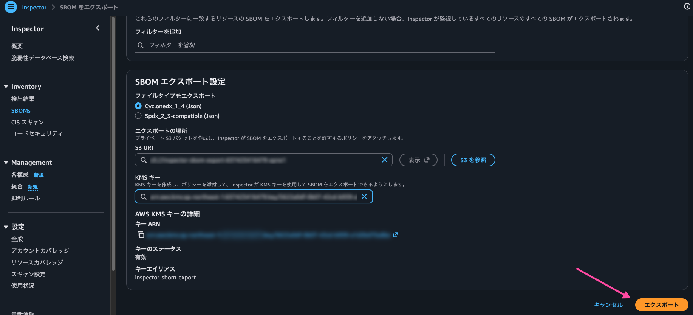

CLI の場合は `create-sbom-export` を使います。今回は形式ごとにプレフィックスを分けて、CycloneDX と SPDX を 1 回ずつエクスポートしました。

```bash
aws inspector2 create-sbom-export \
  --report-format CYCLONEDX_1_4 \
  --s3-destination bucketName=inspector-sbom-export-111111111111,keyPrefix=cyclonedx,kmsKeyArn=arn:aws:kms:ap-northeast-1:111111111111:key/xxxxxxxx-xxxx-xxxx-xxxx-xxxxxxxxxxxx

aws inspector2 create-sbom-export \
  --report-format SPDX_2_3 \
  --s3-destination bucketName=inspector-sbom-export-111111111111,keyPrefix=spdx,kmsKeyArn=arn:aws:kms:ap-northeast-1:111111111111:key/xxxxxxxx-xxxx-xxxx-xxxx-xxxxxxxxxxxx
```

進捗は `get-sbom-export` で確認できます。今回の環境（4 アカウント、50〜60 リソース程度）では、どちらの形式も 2 分ほどで `SUCCEEDED` になりました。

```bash
aws inspector2 get-sbom-export --report-id <reportId> --query status
```

### 出力先の構成

S3 には、リソースごとに 1 つの JSON ファイルが出力されます。パスは `account=`、`resource=` を含む Hive 形式になっているので、Athena でそのままパーティションとして扱えます。

```text
s3://inspector-sbom-export-111111111111/
└── cyclonedx/
    └── CYCLONEDX_1_4_outputs_<reportId>/
        ├── account=222222222222/
        │   ├── resource=AWS_EC2_INSTANCE/
        │   │   └── i-xxxxxxxxxxxxxxxxx_CYCLONEDX_1_4.json
        │   ├── resource=AWS_ECR_CONTAINER_IMAGE/
        │   │   └── arn:aws:ecr:ap-northeast-1:222222222222:repository_<リポジトリ名>_sha256:<ダイジェスト>_CYCLONEDX_1_4.json
        │   └── resource=AWS_LAMBDA_FUNCTION/
        │       └── arn:aws:lambda:ap-northeast-1:222222222222:function:<関数名>:$LATEST_CYCLONEDX_1_4.json
        └── account=333333333333/
            └── ...
```

ECR と Lambda のファイル名には ARN が使われていて（ECR は `/` が `_` に置き換わります）、`:` や `$` を含みます。CLI で個別にダウンロードするときは、キーをシングルクォートで囲みましょう。

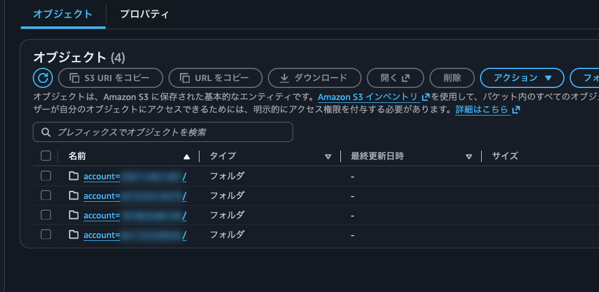

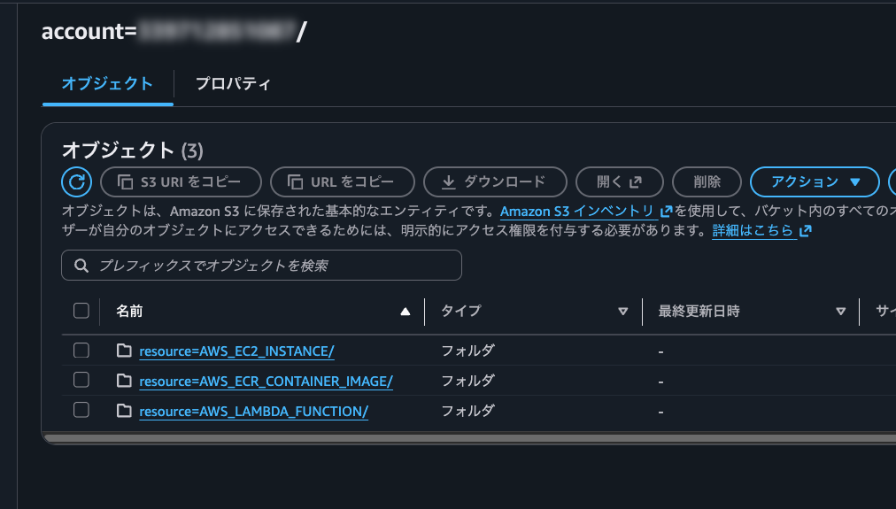

各 JSON ファイルは改行なしの 1 行で出力されていました。Athena の JSON SerDe は 1 行 1 レコードを前提にしているので、そのまま読み込めます。

## Athena の準備

続いて、Athena のワークグループとテーブルを作ります。

### マネージドクエリ結果のワークグループを作る

Athena のクエリ結果の保存先として、今回は「Athena マネージド」を選びました。クエリ結果用の S3 バケットを用意する必要がなく、結果は 24 時間後に自動で削除されます。追加料金もかかりません。

コンソールではワークグループ作成時の「クエリ結果の設定」で「Athena マネージド」を選びます。

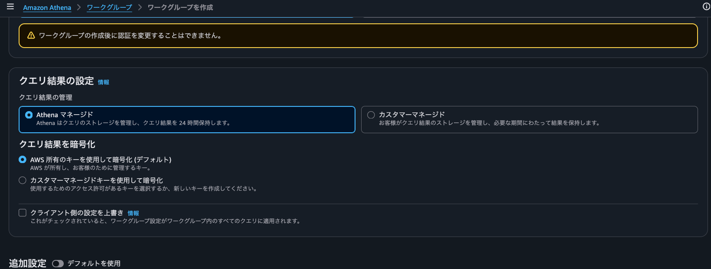

CLI の場合は次のとおりです。

```bash
aws athena create-work-group \
  --name inspector-sbom \
  --configuration '{
    "EngineVersion": {"SelectedEngineVersion": "Athena engine version 3"},
    "ManagedQueryResultsConfiguration": {"Enabled": true},
    "EnforceWorkGroupConfiguration": true
  }'
```

:::message
マネージドクエリ結果はクエリ結果の再利用（Query result reuse）に対応していません。また、200 MB を超える結果はコンソールからダウンロードできないので、大きな結果は `UNLOAD` で S3 に書き出します。
:::

### テーブルを作る

AWS のブログでは Glue クローラーでテーブルを作っていますが、今回は DDL で作りました。必要な列だけを定義できて、形式ごとの違いもわかりやすいからです。

まず Glue のデータベースを作ります。

```sql
CREATE DATABASE inspector_sbom;
```

CycloneDX のテーブルです。`bom-ref` のようにハイフンを含むキーは、バッククォートで囲めばそのまま定義できます。

```sql
CREATE EXTERNAL TABLE cyclonedx (
  bomformat string,
  specversion string,
  metadata struct<
    `timestamp`:string,
    component:struct<type:string,name:string,version:string>,
    properties:array<struct<name:string,value:string>>>,
  components array<struct<
    type:string,name:string,version:string,purl:string,
    `bom-ref`:string,
    properties:array<struct<name:string,value:string>>>>,
  vulnerabilities array<struct<id:string,affects:array<struct<ref:string>>>>
)
PARTITIONED BY (account string, resource string)
ROW FORMAT SERDE 'org.openx.data.jsonserde.JsonSerDe'
LOCATION 's3://inspector-sbom-export-111111111111/cyclonedx/CYCLONEDX_1_4_outputs_<reportId>/';
```

SPDX のテーブルです。

```sql
CREATE EXTERNAL TABLE spdx (
  spdxid string,
  name string,
  spdxversion string,
  documentnamespace string,
  creationinfo struct<created:string,creators:array<string>>,
  packages array<struct<
    spdxid:string,name:string,versioninfo:string,sourceinfo:string,
    externalrefs:array<struct<referencecategory:string,referencetype:string,referencelocator:string>>>>,
  relationships array<struct<spdxelementid:string,relatedspdxelement:string,relationshiptype:string>>
)
PARTITIONED BY (account string, resource string)
ROW FORMAT SERDE 'org.openx.data.jsonserde.JsonSerDe'
LOCATION 's3://inspector-sbom-export-111111111111/spdx/SPDX_2_3_outputs_<reportId>/';
```

作成したら、パーティションを読み込みます。

```sql
MSCK REPAIR TABLE cyclonedx;
MSCK REPAIR TABLE spdx;
```

:::message alert
SBOM はエクスポートのたびに `<reportId>` の違う新しいフォルダに出力されます。最初は `ALTER TABLE ... SET LOCATION` で新しいフォルダに向けようとしましたが、既存のパーティションは古いフォルダを指したままでした。再エクスポートしたときは、テーブルを作り直す（`DROP TABLE` してから `CREATE EXTERNAL TABLE`）のが確実です。外部テーブルなので、`DROP TABLE` しても S3 のデータは消えません。
:::

## Athena でクエリしてみる

実際に Athena で PHP2Shell の影響を調べたクエリと結果を紹介します。前半が CycloneDX、後半が SPDX です。

:::message
結果の表ではアカウント ID をマスクしています。また、読みやすくするためにリソース ID を EC2 の Name タグ、ECR のイメージタグ、Lambda の関数名に置き換えています。
:::

### CycloneDX で組織全体のサマリを出す

最初に、アカウントとリソースタイプごとに「PHP の実行環境があるリソース数」「Composer の PHP ライブラリがあるリソース数」「PHP2Shell の影響を受けるリソース数」を集計します。

PHP の実行環境は次のコンポーネントのどれかがあれば「あり」と判定しています。

- `php/php`: Inspector が検出した PHP の実行ファイル
- `php8.3-cli` など: dpkg や rpm でインストールした PHP
- `php84` など: Alpine の apk でインストールした PHP

```sql
SELECT
  account,
  resource,
  count(*) AS total_resources,
  count_if(any_match(components,
    c -> c.name = 'php/php'
         OR regexp_like(c.name, '^php[0-9.]+-cli$')
         OR regexp_like(c.name, '^php[0-9]+$'))) AS php_runtime,
  count_if(any_match(components,
    c -> c.purl LIKE 'pkg:composer/%')) AS composer_used,
  count_if(any_match(vulnerabilities,
    v -> v.id IN ('CVE-2026-109618', 'CVE-2026-109619'))) AS php2shell_affected
FROM cyclonedx
GROUP BY account, resource
ORDER BY account, resource;
```

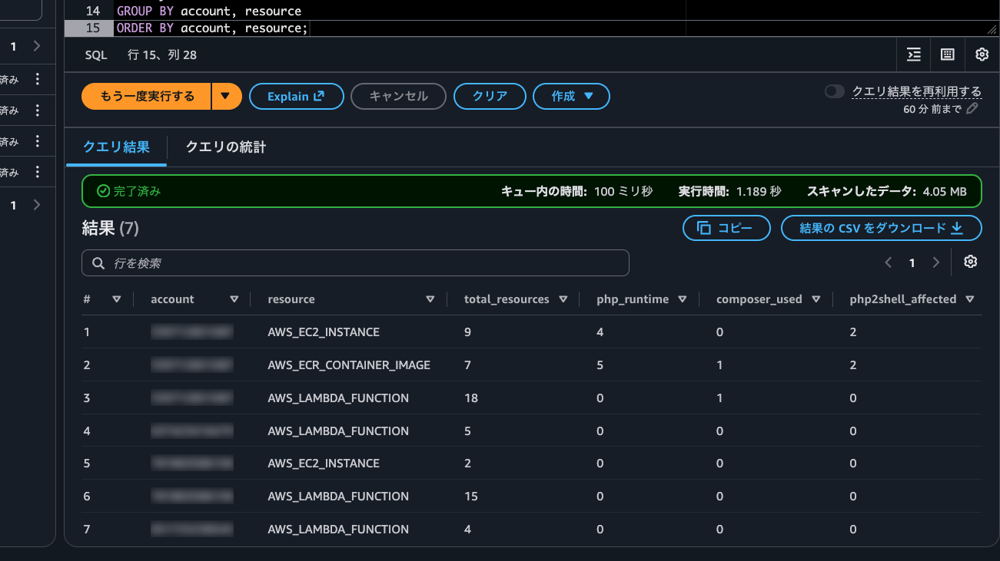

| account | resource | total_resources | php_runtime | composer_used | php2shell_affected |
| --- | --- | --- | --- | --- | --- |
| 111111111111 | AWS_LAMBDA_FUNCTION | 5 | 0 | 0 | 0 |
| 222222222222 | AWS_EC2_INSTANCE | 9 | 4 | 0 | 2 |
| 222222222222 | AWS_ECR_CONTAINER_IMAGE | 7 | 5 | 1 | 2 |
| 222222222222 | AWS_LAMBDA_FUNCTION | 18 | 0 | 1 | 0 |
| 333333333333 | AWS_EC2_INSTANCE | 2 | 0 | 0 | 0 |
| 333333333333 | AWS_LAMBDA_FUNCTION | 15 | 0 | 0 | 0 |
| 444444444444 | AWS_LAMBDA_FUNCTION | 4 | 0 | 0 | 0 |

4 アカウント、60 リソースのうち、PHP の実行環境があるのは EC2 が 4 台、ECR が 5 イメージでした。PHP2Shell の影響を受けるのは EC2 と ECR が 2 つずつです。

想定と違ったのは次の 2 点です。

- PHP を入れた EC2 は 5 台ですが、`sbom-ubuntu2404-php85-ppa` が SBOM に反映されていませんでした
- Lambda は Composer のライブラリがある関数が 1 つ見つかっただけで、PHP の実行環境は 0 件でした。Bref のレイヤーに入っている PHP 8.4.7 も、PHP2Shell の影響ありとは判定されていません

どちらも理由は「注意点」で説明します。

`any_match` は、配列の要素のうち 1 つでも条件を満たせば true を返す関数です。`UNNEST` で展開しなくても、リソース単位の判定ができます。

### CycloneDX で PHP の実行環境と PHP2Shell の該当有無を一覧にする

次に、PHP の実行環境があるリソースを 1 行ずつ出して、PHP2Shell に該当するかどうかを並べます。

```sql
WITH sbom AS (
  SELECT
    account,
    resource,
    map_from_entries(metadata.properties) AS props,
    metadata.component.name AS os,
    components,
    vulnerabilities
  FROM cyclonedx
)
SELECT
  account,
  resource,
  coalesce(
    element_at(props, 'amazon:inspector:resource_arn'),
    element_at(props, 'amazon:inspector:repository_arn') || '@' || element_at(props, 'amazon:inspector:image_id')
  ) AS resource_id,
  os,
  array_join(array_sort(array_distinct(transform(
    filter(components,
      c -> c.name = 'php/php'
           OR regexp_like(c.name, '^php[0-9.]+-cli$')
           OR regexp_like(c.name, '^php[0-9]+$')),
    c -> c.name || ' ' || regexp_extract(c.purl, '@([^?]+)', 1)))), ', ') AS php_runtime,
  array_join(array_sort(transform(
    filter(vulnerabilities, v -> v.id IN ('CVE-2026-109618', 'CVE-2026-109619')),
    v -> v.id)), ', ') AS php2shell_cves
FROM sbom
WHERE any_match(components,
  c -> c.name = 'php/php'
       OR regexp_like(c.name, '^php[0-9.]+-cli$')
       OR regexp_like(c.name, '^php[0-9]+$'))
ORDER BY account, resource, resource_id;
```

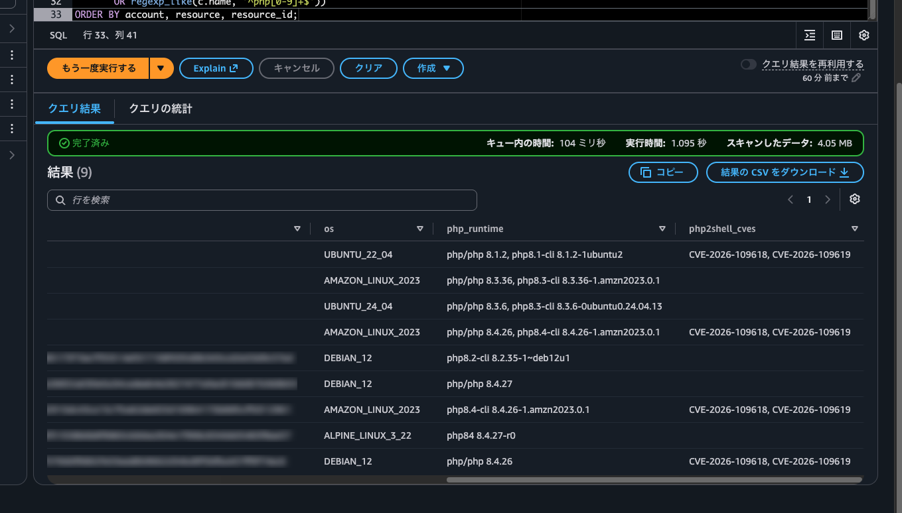

| resource | リソース | os | php_runtime | php2shell_cves |
| --- | --- | --- | --- | --- |
| AWS_EC2_INSTANCE | sbom-ubuntu2204-php81-old | UBUNTU_22_04 | php/php 8.1.2, php8.1-cli 8.1.2-1ubuntu2 | CVE-2026-109618, CVE-2026-109619 |
| AWS_EC2_INSTANCE | sbom-al2023-php83-fixed | AMAZON_LINUX_2023 | php/php 8.3.36, php8.3-cli 8.3.36-1.amzn2023.0.1 | |
| AWS_EC2_INSTANCE | sbom-ubuntu2404-php83-backport | UBUNTU_24_04 | php/php 8.3.6, php8.3-cli 8.3.6-0ubuntu0.24.04.13 | |
| AWS_EC2_INSTANCE | sbom-al2023-php84-vuln | AMAZON_LINUX_2023 | php/php 8.4.26, php8.4-cli 8.4.26-1.amzn2023.0.1 | CVE-2026-109618, CVE-2026-109619 |
| AWS_ECR_CONTAINER_IMAGE | debian12-apt-php | DEBIAN_12 | php8.2-cli 8.2.35-1~deb12u1 | |
| AWS_ECR_CONTAINER_IMAGE | official-8.4.27 | DEBIAN_12 | php/php 8.4.27 | |
| AWS_ECR_CONTAINER_IMAGE | lambda-al2023-php84 | AMAZON_LINUX_2023 | php8.4-cli 8.4.26-1.amzn2023.0.1 | CVE-2026-109618, CVE-2026-109619 |
| AWS_ECR_CONTAINER_IMAGE | alpine-php84 | ALPINE_LINUX_3_22 | php84 8.4.27-r0 | |
| AWS_ECR_CONTAINER_IMAGE | official-8.4.26-app | DEBIAN_12 | php/php 8.4.26 | CVE-2026-109618, CVE-2026-109619 |

ここでは `map_from_entries` で `metadata.properties` を map に変換し、`element_at` で値を取り出しています。EC2 と Lambda は `resource_arn`、ECR は `repository_arn` と `image_id` を `coalesce` で切り替えて、リソース ID にしています。

公式 PHP イメージ（`official-8.4.26-app`、`official-8.4.27`）は、パッケージマネージャー経由の PHP がないため `php/php` だけが記録されていました。それでも `official-8.4.26-app` は PHP2Shell の影響ありと判定されています。ソースからビルドした PHP も、実行ファイルのバージョンから検出できることがわかります。

### バージョン番号による判定

この節では上の結果からわかる注意点を説明します。

`sbom-ubuntu2404-php83-backport` の `php/php` は `8.3.6` です。PHP2Shell の修正バージョンは 8.3.36 なので、このバージョンだけを見ると「影響あり」と判断してしまいます。しかし実際は、Ubuntu が修正をバックポートした `8.3.6-0ubuntu0.24.04.13` で、Inspector も脆弱性を検出していません。CycloneDX の `version` 列も上流のバージョン（`8.3.6`）しか持っていないので、同じ誤判定が起きます。

逆に `sbom-ubuntu2204-php81-old` の PHP 8.1 系は、上流では 2025 年末にサポートが終了しています。IPA の表にも 8.1 系の修正バージョンはありません。それでも Ubuntu 22.04 では `8.1.2-1ubuntu2.28` で修正されていて、Inspector の検出結果にもこのバージョンが修正バージョンとして表示されていました。

ディストリビューションのパッケージは、上流のバージョン番号では修正済みかどうか判断できません。SBOM の `vulnerabilities`（SPDX なら `externalRefs`）に含まれる CVE 情報を使えば、Inspector がディストリビューションのセキュリティアドバイザリを踏まえて判定した結果を利用できます。

なお EC2 の場合、PHP2Shell の CVE は `php8.1-cli` などのディストリビューションのパッケージに紐づいていて、`php/php` には紐づいていませんでした。`php/php` に CVE が紐づいたのは、公式 PHP イメージのようにパッケージマネージャー経由の PHP がない場合だけです。

### CycloneDX で影響を受けるパッケージを洗い出す

AWS のブログで紹介されている、CVE ID からパッケージを引くクエリを PHP2Shell 向けに書き換えました。パッチ適用やイメージの再ビルドの対象を確認するときに使えます。

```sql
WITH sbom AS (
  SELECT
    account,
    resource,
    coalesce(
      element_at(map_from_entries(metadata.properties), 'amazon:inspector:resource_arn'),
      element_at(map_from_entries(metadata.properties), 'amazon:inspector:repository_arn') || '@'
        || element_at(map_from_entries(metadata.properties), 'amazon:inspector:image_id')
    ) AS resource_id,
    components,
    vulnerabilities
  FROM cyclonedx
)
SELECT
  account,
  resource,
  resource_id,
  v.id AS cve_id,
  c.name AS package_name,
  regexp_extract(c.purl, '@([^?]+)', 1) AS version,
  split_part(c.purl, '/', 1) AS purl_type
FROM sbom
CROSS JOIN UNNEST(vulnerabilities) AS t(v)
CROSS JOIN UNNEST(v.affects) AS a(affected)
CROSS JOIN UNNEST(components) AS u(c)
WHERE v.id IN ('CVE-2026-109618', 'CVE-2026-109619')
  AND c."bom-ref" = affected.ref
ORDER BY resource, resource_id, cve_id, package_name;
```

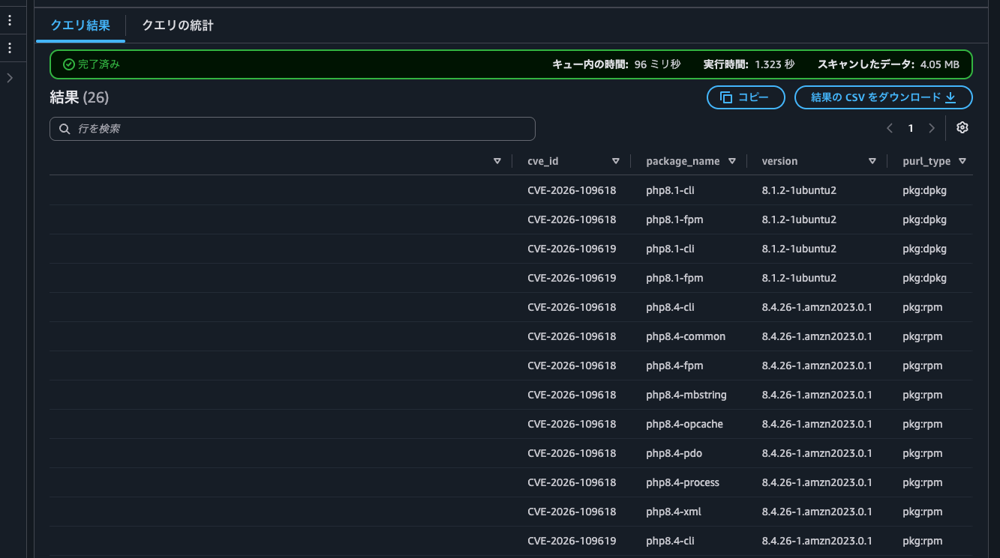

CVE とパッケージの対応は `vulnerabilities[].affects[].ref` とコンポーネントの `bom-ref` で紐づいています。`UNNEST` で展開して、`bom-ref` が一致する組み合わせだけを残しています。

結果は 26 行で、リソースごとの内訳は次のとおりです（CVE ごとに 1 行なので、パッケージ数の 2 倍の行数になります）。

| リソース | 影響を受けるパッケージ | purl_type |
| --- | --- | --- |
| sbom-ubuntu2204-php81-old | `php8.1-cli`、`php8.1-fpm` | `pkg:dpkg` |
| sbom-al2023-php84-vuln | `php8.4-cli`、`php8.4-common`、`php8.4-fpm` など 8 パッケージ | `pkg:rpm` |
| lambda-al2023-php84 | `php8.4-cli`、`php8.4-common` | `pkg:rpm` |
| official-8.4.26-app | `php/php` | `pkg:generic` |

`purl_type` を見ると、OS のパッケージを更新すればよいのか（`pkg:dpkg`、`pkg:rpm`）、ベースイメージを更新して再ビルドする必要があるのか（`pkg:generic`）の見当がつきます。

### CycloneDX で Composer の PHP ライブラリを洗い出す

PHP 本体だけでなく、Composer でインストールした PHP ライブラリも SBOM に含まれます。脆弱性が見つかっている Composer パッケージを一覧にしてみます。

```sql
WITH sbom AS (
  SELECT
    account,
    resource,
    coalesce(
      element_at(map_from_entries(metadata.properties), 'amazon:inspector:resource_arn'),
      element_at(map_from_entries(metadata.properties), 'amazon:inspector:repository_arn') || '@'
        || element_at(map_from_entries(metadata.properties), 'amazon:inspector:image_id')
    ) AS resource_id,
    components,
    vulnerabilities
  FROM cyclonedx
)
SELECT
  account,
  resource,
  resource_id,
  c.name AS package_name,
  c.version,
  array_join(array_agg(element_at(map_from_entries(c.properties), 'amazon:inspector:path')), ', ') AS found_in,
  max(cardinality(filter(vulnerabilities,
    v -> contains(transform(v.affects, a -> a.ref), c."bom-ref")))) AS cve_count
FROM sbom
CROSS JOIN UNNEST(components) AS t(c)
WHERE c.purl LIKE 'pkg:composer/%'
GROUP BY account, resource, resource_id, c.name, c.version
HAVING max(cardinality(filter(vulnerabilities,
    v -> contains(transform(v.affects, a -> a.ref), c."bom-ref")))) > 0
ORDER BY cve_count DESC, resource_id;
```

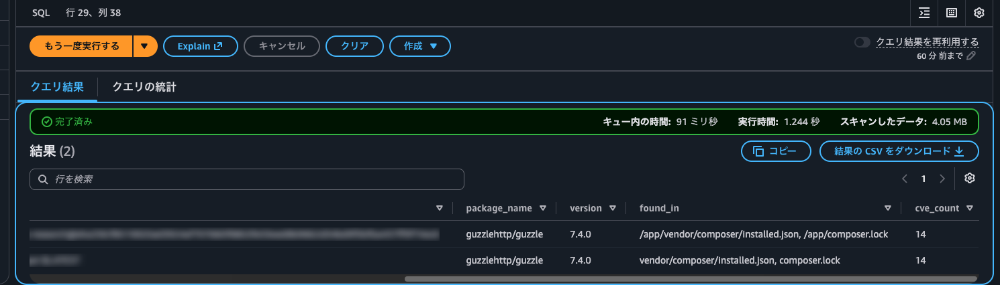

| resource | リソース | package_name | version | found_in | cve_count |
| --- | --- | --- | --- | --- | --- |
| AWS_ECR_CONTAINER_IMAGE | official-8.4.26-app | guzzlehttp/guzzle | 7.4.0 | /app/vendor/composer/installed.json, /app/composer.lock | 14 |
| AWS_LAMBDA_FUNCTION | sbom-php-bref-layer | guzzlehttp/guzzle | 7.4.0 | vendor/composer/installed.json, composer.lock | 14 |

ECR のイメージと Lambda 関数のどちらでも、わざと入れた古い guzzle 7.4.0 が見つかりました。

Composer のパッケージは `composer.lock` と `vendor/composer/installed.json` の両方から検出され、それぞれ別のコンポーネントとして SBOM に入っていました。そのままだと 1 つのパッケージが 2 行になるので、`GROUP BY` でまとめて、検出したファイルのパスを `found_in` に並べています。

Lambda の PHP の実行環境は SBOM に出てきませんでしたが、Composer のパッケージがあれば「この関数は PHP を使っている」と判断する手がかりになります。

### SPDX で PHP の実行環境と PHP2Shell の該当有無を一覧にする

ここからは SPDX で同じ調査をします。SPDX では、パッケージごとの `externalRefs` に CVE ID が入っているので、CycloneDX のような `bom-ref` での突き合わせは不要です。

```sql
SELECT
  account,
  resource,
  CASE resource
    WHEN 'AWS_ECR_CONTAINER_IMAGE' THEN regexp_extract(name, '^[0-9]+/ECR/(.+)$', 1)
    ELSE split_part(name, '/', 3)
  END AS resource_id,
  p.name AS package_name,
  p.versioninfo AS version,
  array_join(array_sort(filter(
    transform(p.externalrefs,
      r -> IF(r.referencecategory = 'SECURITY'
              AND r.referencelocator IN ('CVE-2026-109618', 'CVE-2026-109619'),
              r.referencelocator)),
    x -> x IS NOT NULL)), ', ') AS php2shell_cves
FROM spdx
CROSS JOIN UNNEST(packages) AS t(p)
WHERE p.name = 'php/php'
   OR regexp_like(p.name, '^php[0-9.]+-cli$')
   OR regexp_like(p.name, '^php[0-9]+$')
ORDER BY account, resource, resource_id, package_name;
```

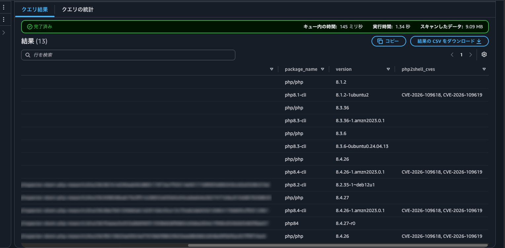

| resource | リソース | package_name | version | php2shell_cves |
| --- | --- | --- | --- | --- |
| AWS_EC2_INSTANCE | sbom-ubuntu2204-php81-old | php/php | 8.1.2 | |
| AWS_EC2_INSTANCE | sbom-ubuntu2204-php81-old | php8.1-cli | 8.1.2-1ubuntu2 | CVE-2026-109618, CVE-2026-109619 |
| AWS_EC2_INSTANCE | sbom-al2023-php83-fixed | php/php | 8.3.36 | |
| AWS_EC2_INSTANCE | sbom-al2023-php83-fixed | php8.3-cli | 8.3.36-1.amzn2023.0.1 | |
| AWS_EC2_INSTANCE | sbom-ubuntu2404-php83-backport | php/php | 8.3.6 | |
| AWS_EC2_INSTANCE | sbom-ubuntu2404-php83-backport | php8.3-cli | 8.3.6-0ubuntu0.24.04.13 | |
| AWS_EC2_INSTANCE | sbom-al2023-php84-vuln | php/php | 8.4.26 | |
| AWS_EC2_INSTANCE | sbom-al2023-php84-vuln | php8.4-cli | 8.4.26-1.amzn2023.0.1 | CVE-2026-109618, CVE-2026-109619 |
| AWS_ECR_CONTAINER_IMAGE | debian12-apt-php | php8.2-cli | 8.2.35-1~deb12u1 | |
| AWS_ECR_CONTAINER_IMAGE | official-8.4.27 | php/php | 8.4.27 | |
| AWS_ECR_CONTAINER_IMAGE | lambda-al2023-php84 | php8.4-cli | 8.4.26-1.amzn2023.0.1 | CVE-2026-109618, CVE-2026-109619 |
| AWS_ECR_CONTAINER_IMAGE | alpine-php84 | php84 | 8.4.27-r0 | |
| AWS_ECR_CONTAINER_IMAGE | official-8.4.26-app | php/php | 8.4.26 | CVE-2026-109618, CVE-2026-109619 |

判定結果は CycloneDX と同じです。`version` 列にはディストリビューションのバージョン番号まで入っているので、パッチ適用状況を目で確認するときは SPDX のほうが読みやすいと感じました。パッケージごとに CVE が付くので、EC2 では `php/php` に CVE が紐づいていないことも一目でわかります。

一方、SPDX には CycloneDX の `metadata.properties` のような項目がなく、リソース ARN や OS 名を直接取り出せません。ECR だけは `documentNamespace` に `ECR://DEBIAN_12/...` のように OS 名が入っていました。リソース ID は `name` から取り出しています。ECR の `name` はリポジトリ ARN の中にも `/` を含むので、ECR だけ正規表現で切り出しています。

### SPDX で影響を受けるパッケージを洗い出す

SPDX で影響パッケージを一覧にするクエリです。`externalRefs` を展開して、CVE ID で絞り込むだけです。

```sql
SELECT
  account,
  resource,
  CASE resource
    WHEN 'AWS_ECR_CONTAINER_IMAGE' THEN regexp_extract(name, '^[0-9]+/ECR/(.+)$', 1)
    ELSE split_part(name, '/', 3)
  END AS resource_id,
  r.referencelocator AS cve_id,
  p.name AS package_name,
  p.versioninfo AS version
FROM spdx
CROSS JOIN UNNEST(packages) AS t(p)
CROSS JOIN UNNEST(p.externalrefs) AS u(r)
WHERE r.referencecategory = 'SECURITY'
  AND r.referencelocator IN ('CVE-2026-109618', 'CVE-2026-109619')
ORDER BY resource, resource_id, cve_id, package_name;
```

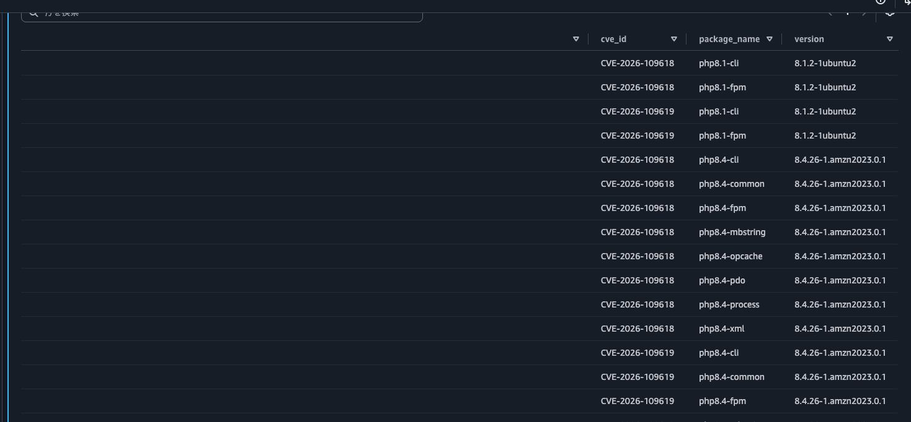

こちらも CycloneDX と同じ 26 行が出力されました。

### CycloneDX と SPDX の比較

この節では両方の形式でクエリしてみてわかった違いをまとめます。

| 観点 | CycloneDX | SPDX |
| --- | --- | --- |
| CVE とパッケージの紐づけ | `bom-ref` での突き合わせが必要 | パッケージに直接紐づいていて簡単 |
| バージョンの見やすさ | `version` は上流のみ。完全なバージョンは `purl` から抽出 | `versionInfo` に完全なバージョン |
| リソース情報 | ARN、OS 名などを `metadata.properties` から取得できる。ECR はリポジトリ ARN とダイジェスト | `name` を分割してリソース ID を取得。OS 名はない |
| Athena のスキャン量（組織全体） | 約 4.05 MB | 約 9.09 MB |

どちらでも同じ結果を得られました。リソースの ARN や OS 名で絞り込んだり集計したりするなら CycloneDX、パッケージ単位で脆弱性とバージョンを確認するなら SPDX が書きやすいと感じました。組織の規模が大きくなるほどスキャン量の差も大きくなるので、まずは CycloneDX で始めるのがよさそうです。

## 注意点

この章では検証中に気づいた注意点をまとめます。

### SBOM に入る情報の時点

エクスポートされる SBOM の中身は、Inspector が最後にスキャンした時点の情報です。SBOM の `timestamp` はエクスポートした時刻になるので、ここを見ても古さには気づけません。

`sbom-ubuntu2404-php85-ppa` では、起動直後の 0:47 に最初のスキャンが走り、その後 0:49 ごろに PHP 8.5 のインストールが終わりました。SSM のインベントリには 1:16 の時点で `php8.5-cli 8.5.12-1+ubuntu24.04.1+deb.sury.org+1` が記録されていました。しかし Inspector の再スキャンは 1 時間以上たっても行われず、その間にエクスポートした SBOM には PHP が含まれていませんでした。

対象リソースの最終スキャン日時は Inspector コンソールのアカウント管理画面や、CLI の `list-coverage` で確認できます。

```bash
aws inspector2 list-coverage \
  --filter-criteria '{"resourceType":[{"comparison":"EQUALS","value":"AWS_EC2_INSTANCE"}]}' \
  --query 'coveredResources[].[accountId,resourceId,lastScannedAt]' \
  --output table
```

最近パッケージを入れたばかりのリソースがありそうなら、SSM のインベントリ（`AWS:Application`）もあわせて確認すると安心です。

### Lambda レイヤーの PHP 本体

Lambda の SBOM には、PHP の実行環境が含まれませんでした。`sbom-php-bref-layer` の SBOM を確認すると、34 個のコンポーネントがすべて Composer のパッケージ（`pkg:composer`）でした。Bref のレイヤーに入っている PHP 8.4.7 の実行ファイルは記録されておらず、PHP2Shell の検出結果も出ていません。

```sql
SELECT
  cardinality(components) AS total,
  cardinality(filter(components, c -> c.purl LIKE 'pkg:composer/%')) AS composer
FROM cyclonedx
WHERE element_at(map_from_entries(metadata.properties), 'amazon:inspector:function_name') = 'sbom-php-bref-layer';
-- total: 34, composer: 34
```

Inspector のユーザーガイドでも、Lambda の標準スキャンは「プログラミング言語のパッケージ」の脆弱性をスキャンするものと説明されています。対応ランタイムの一覧に PHP はなく、カスタムランタイム（AL2、AL2023）が載っているだけです。一方で、Composer のパッケージは今回検出されていました。

https://docs.aws.amazon.com/inspector/latest/user/supported.html

Lambda で PHP を使っているかどうかは、SBOM の Composer パッケージや、関数に付いているレイヤーから調べる必要があります。レイヤーの一覧は Lambda の API で確認できます。

```bash
aws lambda get-function --function-name sbom-php-bref-layer --query 'Configuration.Layers[].Arn'
# ["arn:aws:lambda:ap-northeast-1:534081306603:layer:php-84:25"]
```

### コンテナイメージの Lambda 関数

コンテナイメージで作った `sbom-php-container-image` は Inspector のカバレッジで `UNSUPPORTED_RUNTIME` となり、Lambda としてはスキャンされませんでした。そのため Lambda の SBOM にも含まれていません。

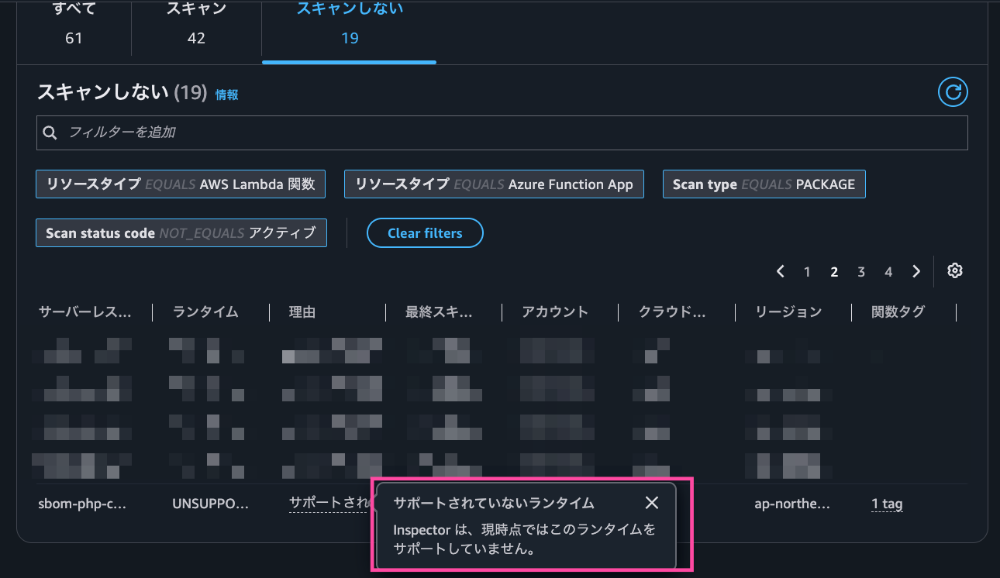

ただし、関数が使っているイメージは ECR 側でスキャンされていて、`lambda-al2023-php84` として PHP2Shell の影響ありと判定されています。関数とイメージの対応は、`get-function` の `ResolvedImageUri` に含まれるダイジェストで確認できます。

```bash
aws lambda get-function --function-name sbom-php-container-image --query 'Code.ResolvedImageUri'
# "222222222222.dkr.ecr.ap-northeast-1.amazonaws.com/inspector-sbom-php-research@sha256:86e7b810..."
```

このダイジェストが CycloneDX の `amazon:inspector:image_id` と一致します。ECR の SBOM にはイメージタグが含まれないので、タグを知りたいときは `aws ecr describe-images` で引きます。コンテナイメージの Lambda 関数はこのように ECR 側の SBOM で調べます。

### Inspector のスキャン対象外のリソース

SBOM がエクスポートされるのは、Inspector がスキャンしているリソースだけです。SSM Agent が動いていない EC2（エージェントレススキャンも未設定の場合）や、上で紹介したコンテナイメージの Lambda 関数は含まれません。Inspector を有効にしていないリージョンのリソースも同じです。「SBOM に出てこない = PHP がない」とは限らない点に注意が必要です。

## まとめ

Amazon Inspector の SBOM エクスポートと Athena を使って、PHP2Shell の影響を組織横断で調べてみました。

- 委任管理者アカウントから組織全体の SBOM を一括でエクスポートでき、Athena で EC2・ECR・Lambda をまとめて調べられた
- CycloneDX と SPDX のどちらでも同じ調査ができた。集計なら CycloneDX、パッケージ単位の確認なら SPDX が書きやすい
- ディストリビューションのパッケージは上流のバージョン番号では判断できないので、SBOM の CVE 情報で判定するのが確実
- 公式 PHP イメージのようにソースからビルドした PHP も `php/php` として検出できた
- Lambda レイヤーの PHP 本体と、コンテナイメージの Lambda 関数は Lambda の SBOM に含まれないので、レイヤーの確認や ECR 側の SBOM で補う

Inspector の検出結果（Findings）でも PHP2Shell の該当リソースはわかります。SBOM を使うと、それに加えて「PHP が入っているが修正済みのリソース」も同じクエリで確認できます。次に大きな脆弱性が出たときも、CVE ID とパッケージ名を書き換えればそのまま使えるので、ぜひ試してみてください。

この記事がどなたかの役に立つと嬉しいです。
