こんにちは、CSC の [CloudFastener](https://cloud-fastener.com/) というプロダクトで TAM のポジションで働いている平木です！

皆さんは AWS のセキュリティ運用にセキュリティ成熟度モデルを使用していますか？

AWS 環境のセキュリティ運用で「次に何をやるか」を決めるとき、AWS セキュリティ成熟度モデル（AWS Security Maturity Model）を指針として使うケースが多くありました。これまでは v2 が主流で、v2 への更新はクラスメソッドさんの記事で紹介されています。

https://dev.classmethod.jp/articles/released-aws-security-maturity-model-v2/

今回サイトを確認してみると、v3 の「AWS Cloud Security Maturity Model」が公開されていました。さらに「PCI DSS Security Maturity Model」と「AI Security Maturity Model」という 2 つのエディションも増えていました。アセスメント用のツールも Excel からブラウザで動く Web アプリに変わっていたので、v2 からの差分と、それぞれのモデル、評価ツールの使い方をまとめてみました。

:::message
この記事の 3 行まとめ

- 成熟度モデルは `smm.security.aws.dev` に移り、Cloud・PCI DSS・AI の 3 エディション構成になった
- Cloud 版 v3 は AWS CAF の 9 つのセキュリティ領域に整理し直され、AI やエージェント型のテストなど 5 つのコントロールが新しく追加された
- 評価ツールはブラウザ内で完結する Web アプリになり、AWS からのデータ収集や Amazon Bedrock による分析、PowerPoint などへのエクスポートに対応した
:::

:::message alert
2026 年 11 月 25 日時点で公開されている内容をもとにしています。v3 は 2026 年 9 月の公開以降も短い間隔で更新されているため、最新の内容は各サイトの Changelog で確認してください。
:::

v2 と v3（Cloud 版）の主な違いは次のとおりです。

| 項目 | v2 | v3（Cloud 版） |
| --- | --- | --- |
| サイト | maturitymodel.security.aws.dev | cloud.smm.security.aws.dev |
| 縦軸 | 10 カテゴリ（CAF の 9 領域 + Resiliency） | AWS CAF の 9 つのセキュリティ領域 |
| 横軸 | 4 フェーズ（Quick Wins / Foundational / Efficient / Optimized） | 4 フェーズ（同じ） |
| コントロール数 | 74 | 75 |
| フレームワークとの対応 | AWS CAF（セキュリティの観点） | AWS CAF、Well-Architected、NIST CSF、CIS |
| 各コントロールの記載 | 説明、実装方法、学習用の動画など | 工数・影響度、実装ガイダンス、検証方法、対処する脅威、料金、フレームワークの対応 |
| 日本語 | あり | あり |
| アセスメント | Excel シート | Web アプリの評価ツール |
| 関連エディション | なし | PCI DSS 版、AI 版 |

## AWS セキュリティ成熟度モデルとは

AWS セキュリティ成熟度モデルは、AWS のセキュリティスペシャリストが作成した、セキュリティ対策の優先順位付けに使うモデルです。

セキュリティの領域を縦軸に、成熟度のフェーズを横軸に取ったマトリクスになっていて、労力が小さく効果が大きい対策（Quick Wins）から順に取り組めるように整理されています。

v3 のサイトでは、このモデルが測るのはコントロールの採用状況と成熟度であり、コンプライアンスや認証ではないと明記されています。監査対応のチェックリストというより、自分たちがどこまでできていて、次に何をやるかを決めるためのロードマップとして使うものです。

## 3 つのエディションに分かれた Security Maturity Model

v3 からは共通のプラットフォームの上に 3 つのエディションが並ぶ構成になりました。3 つのエディションには次のランディングページからアクセスできます。

https://smm.security.aws.dev/

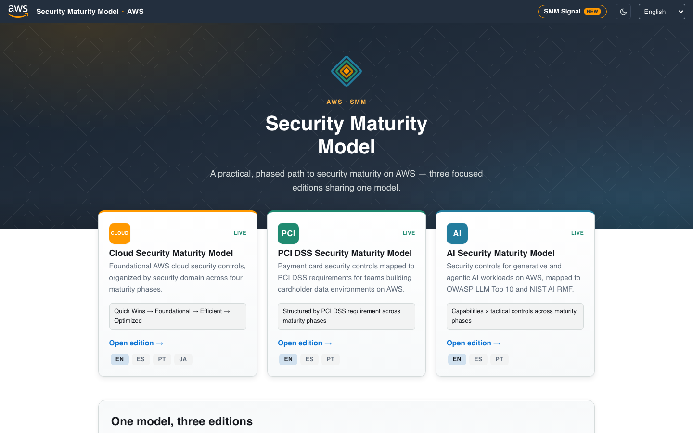

3 つのエディションの違いは次のとおりです。

| エディション | 縦軸 | 横軸（フェーズ） | コントロール数 | 主な対応フレームワーク | 言語 | バージョン |
| --- | --- | --- | --- | --- | --- | --- |
| [Cloud Security Maturity Model](https://cloud.smm.security.aws.dev/ja/) | AWS CAF の 9 つのセキュリティ領域 | Quick Wins / Foundational / Efficient / Optimized | 75 | AWS CAF、Well-Architected、NIST CSF、CIS | 英語、スペイン語、ポルトガル語、日本語 | v3.2.1 |
| [PCI DSS Security Maturity Model](https://pci.smm.security.aws.dev/en/) | PCI DSS v4.0.1 の 12 要件 | Quick Wins / Foundational / Efficient / Optimized | 54 | PCI DSS v4.0.1 | 英語、スペイン語、ポルトガル語 | v1.1.0 |
| [AI Security Maturity Model](https://ai.smm.security.aws.dev/en/) | AI の 6 つのケイパビリティ | Foundational / Enhanced / Advanced | 56 | OWASP LLM Top 10、NIST AI RMF、Well-Architected Generative AI Lens | 英語、スペイン語、ポルトガル語 | v1.0.0 |

日本語に対応しているのは今のところ Cloud 版だけです。PCI DSS 版と AI 版は英語で読むことになります。

## Cloud Security Maturity Model v3 の変更点

Cloud 版は v2 の後継にあたるモデルです。

https://cloud.smm.security.aws.dev/ja/

### 縦軸のセキュリティ領域

v2 では AWS CAF の 9 つのセキュリティ領域に Resiliency（回復性）を加えた 10 カテゴリでした。v3.1 で Resiliency が削除され、CAF の 9 領域に合わせた構成になりました。

| # | セキュリティ領域 | Quick Wins | Foundational | Efficient | Optimized |
| --- | --- | --- | --- | --- | --- |
| 1 | セキュリティガバナンス | 2 | 3 | 3 | 1 |
| 2 | セキュリティ保証 | 1 | 1 | 1 | 1 |
| 3 | アイデンティティとアクセス管理 | 4 | 3 | 2 | 3 |
| 4 | 脅威検知 | 3 | 1 | 2 | 2 |
| 5 | 脆弱性管理 | 0 | 2 | 3 | 1 |
| 6 | インフラストラクチャ保護 | 1 | 5 | 2 | 2 |
| 7 | データ保護 | 2 | 4 | 2 | 1 |
| 8 | アプリケーションセキュリティ | 1 | 2 | 4 | 1 |
| 9 | インシデントレスポンス | 1 | 1 | 4 | 3 |
| | 合計 | 15 | 22 | 23 | 15 |

Resiliency にあったコントロールのうち、マルチ AZ 冗長性はインフラストラクチャ保護へ、災害復旧計画とマルチリージョンの災害復旧の自動化はデータ保護へ移っています。

マトリクスのページでは縦軸を AWS CAF のほかに Well-Architected のセキュリティの柱や NIST CSF に切り替えて表示できます。Well-Architected Framework Review や NIST CSF ベースの評価をしている組織でも、普段の分類のまま見られるのは便利です。

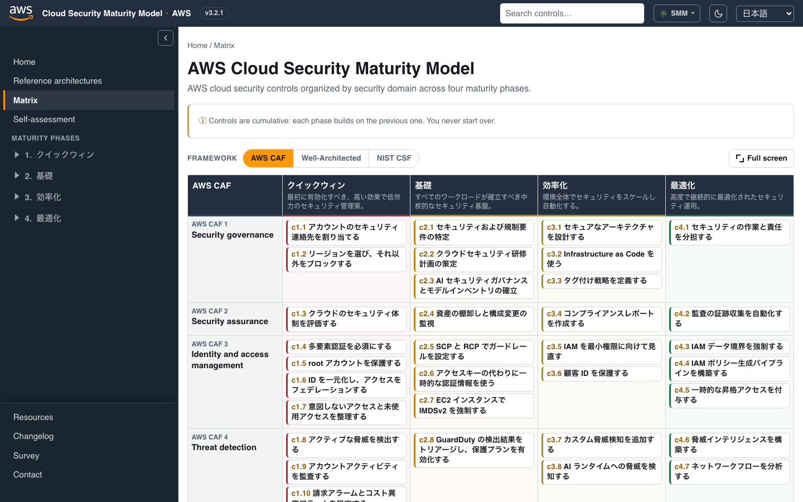

### コントロールの追加・統合・移動

v2 の 74 項目と v3.2.1 の 75 コントロールを突き合わせると、新しく追加されたのは AI とエージェントに関わるものを中心に次の 5 つでした。

| ID | コントロール | フェーズ | 領域 | 主な AWS サービス |
| --- | --- | --- | --- | --- |
| c2.3 | AI セキュリティガバナンスとモデルインベントリの確立 | Foundational | セキュリティガバナンス | AWS Security Hub、Amazon Inspector、Amazon GuardDuty |
| c3.8 | AI ランタイムへの脅威を検知する | Efficient | 脅威検知 | Amazon GuardDuty（AI Protection） |
| c3.11 | エージェント型ペネトレーションテストを採用する | Efficient | 脆弱性管理 | AWS Continuum |
| c3.17 | デリバリーにエージェント型セキュリティレビューを追加する | Efficient | アプリケーションセキュリティ | AWS Continuum |
| c3.22 | マネージドインシデント対応を手配する | Efficient | インシデントレスポンス | AWS Security Incident Response |

c3.8 では盗んだ認証情報で生成 AI を不正利用する LLMjacking や、プロンプトインジェクション、ロギングやガードレールの改ざんを検知対象として挙げています。  
c3.17 は、AI コーディングアシスタントが生成したコードや MCP サーバー、プロンプトも含めてレビューの対象にするという内容で、生成 AI を開発に使う前提で書かれています。

一方で、削除または他のコントロールに統合されたのは次の 4 項目です。

| v2 の項目 | v2 のフェーズ | v3 での扱い |
| --- | --- | --- |
| Evaluate Resilience（AWS Resilience Hub） | Quick Wins | Resiliency 領域とともに削除 |
| Chaos Engineering | Optimized | Resiliency 領域とともに削除 |
| Secure EC2 Instances Management | Foundational | c1.11「リスクのある管理ポートの開放を閉じる」に統合 |
| Advanced Automations | Optimized | c3.20「重要なプレイブックを自動化する」に統合 |

フェーズが変わったものもあります。

| コントロール | v2 | v3 |
| --- | --- | --- |
| アンチマルウェア／EDR（c2.12） | Efficient | Foundational |
| 生成 AI ワークロードのデータ保護（c2.14） | Optimized | Foundational |

生成 AI のデータ保護が Optimized から Foundational に下りてきたのは、生成 AI を使うことがもう特別ではなく、基礎として押さえるべきものになったという判断だと思います。

なお、v3 のコントロールは `c1.1` のような ID で管理されています。v2 の項目名とは一対一で対応しない部分もあるので、v2 で進めていた評価結果を引き継ぐときは、上の表のような対応を一度整理しておくと迷いにくいです。

### コントロールの詳細ページ

v3 では各コントロールのページの情報量が増え、次の情報がまとまっています。

- 工数と影響度
- 実装ガイダンス（CLI やポリシーの例を含む）
- 検証方法（How to validate）
- 対処する脅威（Threats addressed）
- 使用する AWS サービスと料金
- AWS CAF、Well-Architected、NIST CSF との対応

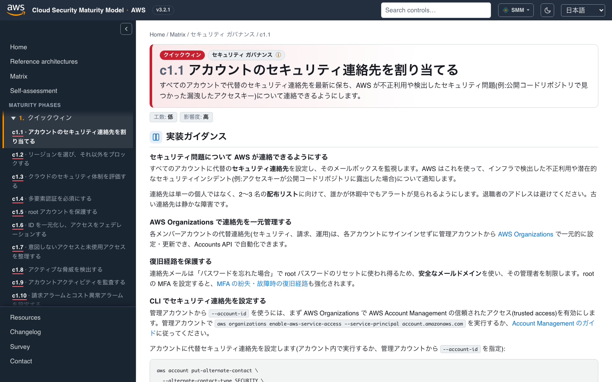

検証方法が書かれているので、「設定したつもり」になっていないかを確認するチェック項目としても使えます。コード例には「これは一例です」という注記と公式ドキュメントへのリンクが付いているので、そのまま使うのではなく、自分の環境に合わせて調整してから適用するのがよさそうです。

### v2 のサイトの扱い

旧サイトは今もアクセスできますが、v3 が公開されたことを知らせるダイアログとバナーが表示されます。

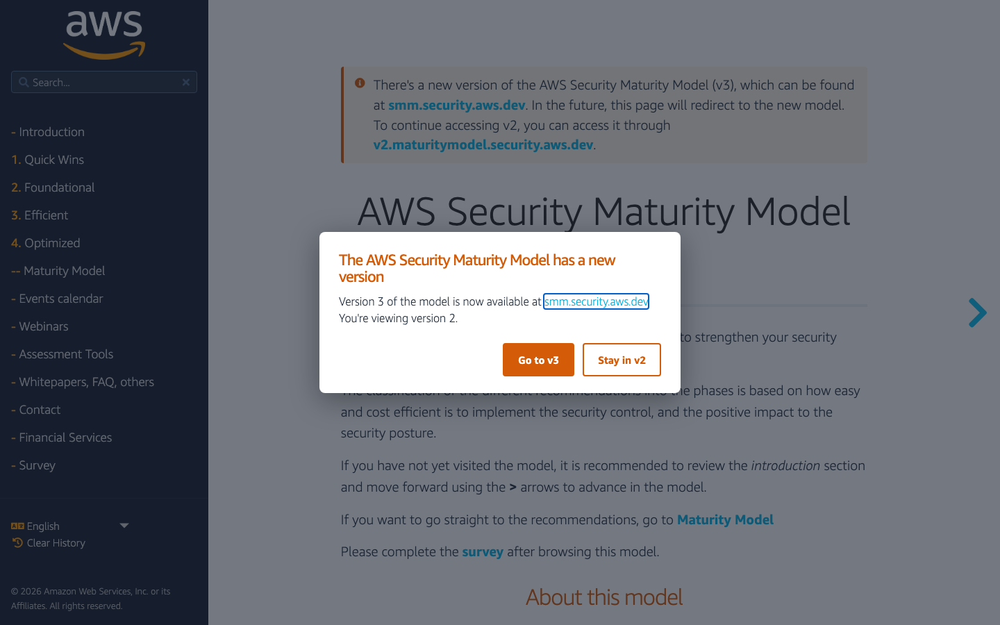

バナーには、将来このページは新しいモデルにリダイレクトされること、v2 は `v2.maturitymodel.security.aws.dev` から引き続き参照できることが書かれています。v2 を前提に資料や評価を作っている場合は、リンク先を見直しておくとよいです。

## PCI DSS Security Maturity Model

PCI DSS 版は PCI DSS v4.0.1 の 12 要件を縦軸に、Cloud 版と同じ 4 フェーズを横軸に取ったモデルです。カード会員データ環境（CDE）を AWS 上で構築・運用するチーム向けです。

https://pci.smm.security.aws.dev/en/

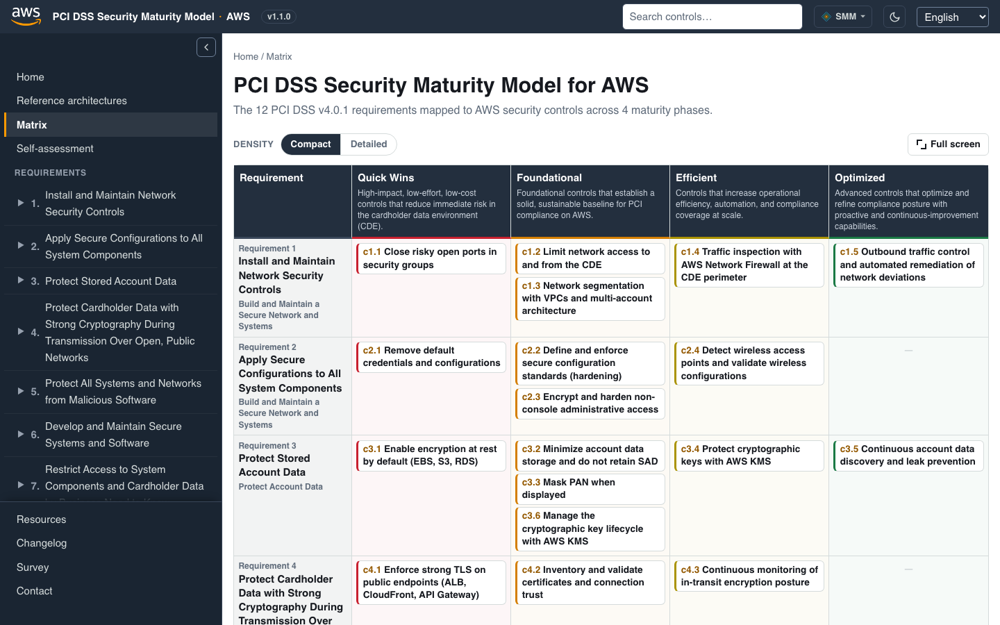

Cloud 版との違いとして、次のような PCI DSS ならではの情報が各推奨事項に付いています。

- `PCI sub-requirements covered`
  - 推奨事項が対応する PCI DSS のサブ要件
- `PCI validation`
  - `Testing procedures`
    - テスト手順
  - `Evidence in AWS`
    - AWS で提示できるエビデンス
- 責任共有の区分（customer / aws / shared）
  - AWS PCI DSS の OSCAL System Security Plan をもとに分類されている
- `Customized approach`
  - 対象となる要件のカスタマイズドアプローチの目的（`Customized Approach Objective`）
- CDE に該当するかどうか

PCI DSS v4.0.1 では要件を書かれたとおりに実装する「定義されたアプローチ」のほかに、要件の目的を満たす独自のコントロールを設計する「カスタマイズドアプローチ」を選べます。推奨事項ごとにカスタマイズドアプローチの目的が書かれているので、どちらで要件を満たすかを検討するときの材料になります。

また、CDE をホストするための 2 つのリファレンスアーキテクチャが用意されています。

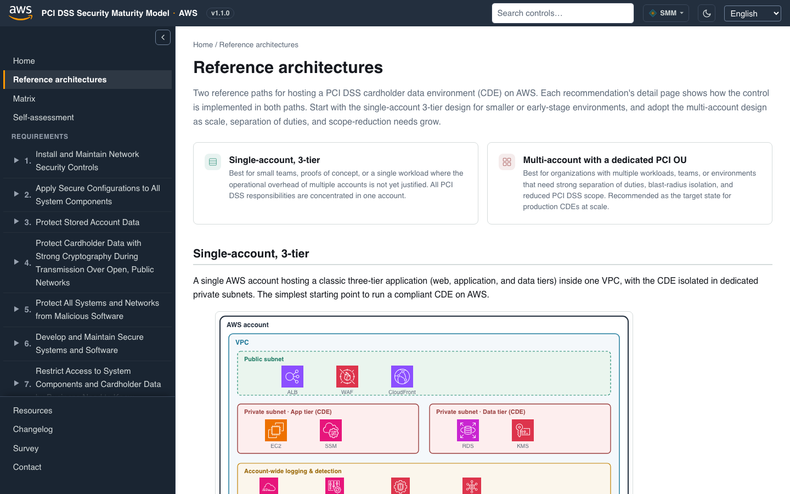

| アーキテクチャ | 向いているケース |
| --- | --- |
| シングルアカウントの 3 層構成 | 小規模なチーム、PoC、ワークロードが 1 つだけの環境 |
| PCI 専用の OU を持つマルチアカウント構成 | 職務分離や影響範囲の分離、PCI DSS の対象範囲の縮小が必要な環境。本番の CDE の目標状態として推奨されている |

各推奨事項のページには「Practical implementation」として、2 つのアーキテクチャそれぞれでの実装方法が書かれています。たとえば CDE を同じアカウント内のサブネットで分離するのか、PCI OU 配下の専用アカウントで分離するのかの違いを、コントロールごとに比べられます。

:::message
PCI DSS 版の Changelog では、初版（v1.0.0）の推奨事項は 51 件と書かれています。2026 年 11 月 25 日時点のマトリクスと自己評価のページでは 54 件になっていたため、本記事では 54 件と記載しています。
:::

## AI Security Maturity Model

AI 版は生成 AI とエージェント型 AI のワークロードを対象にしたモデルです。AWS Security Reference Architecture（SRA）for AI の 6 つのケイパビリティを縦軸に、3 つのフェーズを横軸に取っています。

https://ai.smm.security.aws.dev/en/

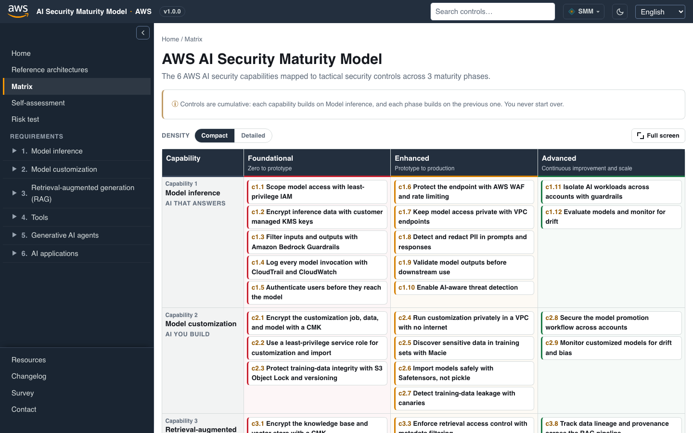

| ケイパビリティ | 内容 | コントロール数 |
| --- | --- | --- |
| Model inference | モデルの推論 | 12 |
| Model customization | モデルのカスタマイズ（ファインチューニングなど） | 9 |
| Retrieval-augmented generation (RAG) | 検索拡張生成 | 9 |
| Tools | エージェントが呼び出すツール | 8 |
| Generative AI agents | 生成 AI エージェント | 10 |
| AI applications | AI アプリケーション | 8 |

フェーズは Cloud 版と異なり、Foundational（ゼロからプロトタイプまで）、Enhanced（プロトタイプから本番まで）、Advanced（継続的な改善とスケール）の 3 段階です。  
どのケイパビリティも Model inference のコントロールの上に積み上がる前提になっています。たとえばエージェントを作るなら、推論のコントロールに加えてエージェントのコントロールを見ることになります。

各コントロールは OWASP の LLM Top 10 と Agentic Top 10 に対応付けられています。NIST AI RMF や Well-Architected Generative AI Lens との対応もあります。

さらに、AWS Security Hub の AI Security Best Practices 標準のどのチェックで検証できるかも示されています。  
ただし Security Hub で確認できるのは暗号化やネットワーク分離などの設定面だけです。ガバナンスや人による承認、プロンプトの強化のように機械的に検出できないコントロールは対象外と書かれています。

### Risk test で AI のユースケースのリスクを確認する

AI 版には、作ろうとしている AI のユースケースのリスクを 3 つの質問で判定する「Risk test」というページがあります。

https://ai.smm.security.aws.dev/en/risk-test/

まず、作るものが Inference、RAG、Tools、Agents、Applications のどれに近いかを選びます。そのうえで、次の 3 つの質問に答えます。

1. 信頼できない外部のコンテンツ（プロンプト、文書、メール、Web ページ、ツールの結果など）を読み込むか
2. 機密データや顧客情報、認証情報に触れるか
3. 状態を変更したり、データを外部に送信したりできるか

3 つすべてに当てはまると「High risk」と判定され、選んだケイパビリティと回答に応じて推奨されるコントロールが表示されます。次の画面は Agents を選び、3 つの質問すべてに当てはまると答えた例です。

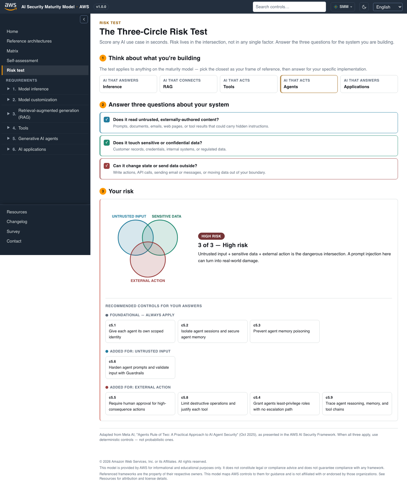

この判定は Meta AI の「Agents Rule of Two」をもとにしていて、3 つすべてに当てはまる場合は確率的なコントロールではなく決定的なコントロールを使うよう案内されています。  
たとえば Guardrails によるフィルタリングだけに頼らず、人による承認（c5.5）や破壊的な操作の制限（c5.8）を組み合わせる、という考え方です。AI エージェントの企画段階で、どこまで対策が必要かを関係者と話す材料として使いやすいと感じました。

## 評価ツールを試す

v2 では Excel のアセスメントシートが配布されていましたが、v3 では Web アプリの評価ツールが用意されています。

https://assessment-tool.smm.security.aws.dev/

オープンソース版のビルドにはログイン機能もバックエンドもありません。評価データはブラウザのローカルストレージに保存され、AWS からのデータ収集や Bedrock による分析も、ブラウザから AWS のエンドポイントに直接リクエストを送る仕組みです。この点は SMM のブログである SMM Signal の記事で説明されています。

https://smm.security.aws.dev/signal/self-assessment-in-the-browser/

### 評価するモデルを選ぶ

ツールを開くと、最初にどのモデルで評価するかを選ぶダイアログが表示されます。

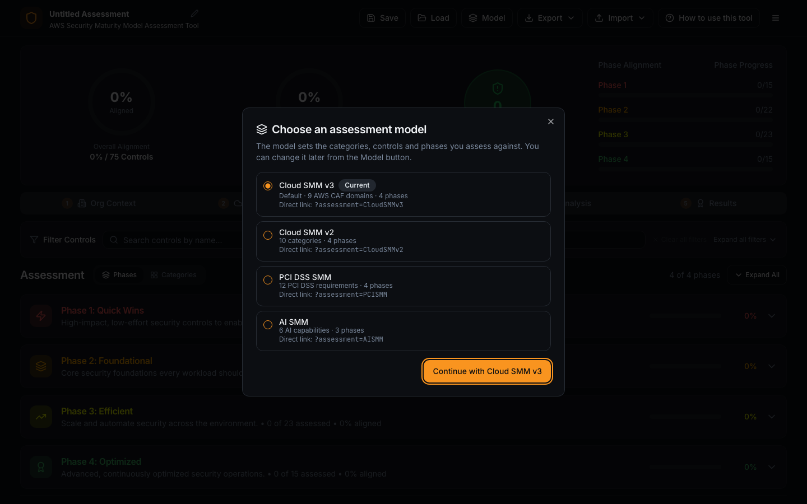

選べるのは Cloud SMM v3、Cloud SMM v2、PCI DSS SMM、AI SMM の 4 つです。v2 も選べるので、v2 で評価を続けている組織も同じツールを使えます。

上記の SMM Signal の記事（2026 年 11 月 18 日公開）では、評価ツールが対応しているのは Cloud 版のみと書かれていました。ただ、11 月 25 日時点では PCI DSS 版と AI 版も選べるようになっていました。

モデルを選ぶと、評価の流れを説明するダイアログが表示されます。

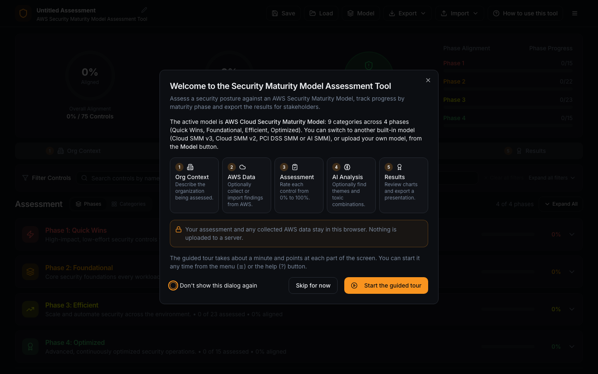

評価は次の 5 つのステップで進めます。

| ステップ | 内容 |
| --- | --- |
| 1. Org Context | 評価対象の組織や AWS 環境（アカウント数、デプロイモデル、利用リージョンなど）を記録する |
| 2. AWS Data | 任意。AWS から設定情報や検出結果を収集、またはインポートする |
| 3. Assessment | コントロールごとに整合度を 0〜100% で記録する |
| 4. AI Analysis | 任意。Amazon Bedrock で共通するテーマや危険な組み合わせを分析する |
| 5. Results | グラフで結果を確認し、レポートとしてエクスポートする |

### コントロールごとに整合度を記録する

評価のメインになる `Assessment` タブでは、フェーズごとにコントロールが並んでいて、それぞれの整合度をプルダウンから選びます。

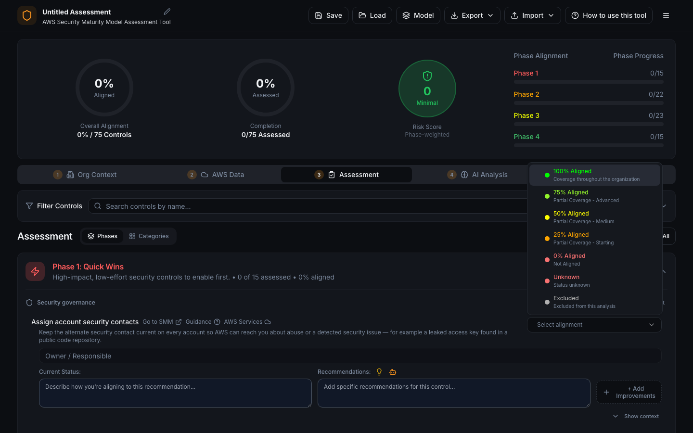

選択肢は次のとおりです。

| 選択肢 | 意味 |
| --- | --- |
| 100% Aligned | 組織全体で対応できている |
| 75% Aligned | 部分的に対応（進んでいる） |
| 50% Aligned | 部分的に対応（中程度） |
| 25% Aligned | 部分的に対応（着手段階） |
| 0% Aligned | 対応できていない |
| Unknown | 状況がわからない |
| Excluded | 評価の対象外 |

コントロールごとに、担当者（Owner / Responsible）、現状（Current Status）、改善の推奨事項（Recommendations）も書き込めます。`Go to SMM` からはモデルのサイトの該当コントロールに移動できるので、実装ガイダンスを確認しながら評価を進められます。

### AWS からデータを集める

`AWS Data` タブでは評価の判断材料になる情報を集められます。この機能は BETA と表示されていました。

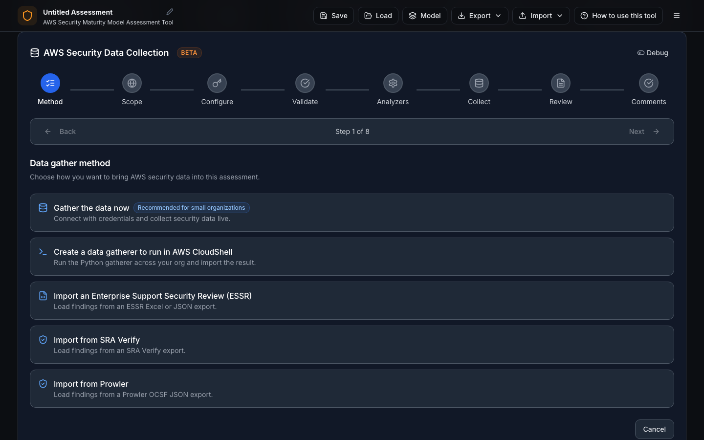

データを集める方法は次の 5 つです。

- 認証情報を入力して、その場で収集する（小規模な組織向けと表示されている）
- AWS CloudShell で実行する Python のデータ収集スクリプトを作成し、組織全体で実行した結果をインポートする
- Enterprise Support Security Review（ESSR）の Excel または JSON をインポートする
- SRA Verify のエクスポートをインポートする
- Prowler の OCSF JSON をインポートする

組織全体から収集する場合は、各メンバーアカウントの読み取り専用ロール（既定の名前は `SMMAssessmentRole`）を引き受けて情報を読み取ります。すでに Prowler などでスキャンしている場合は、その結果を取り込めるのも便利です。

### Amazon Bedrock で分析する

`AI Analysis` タブでは Bedrock の API キーとリージョン、モデルを指定して、評価結果を分析できます。回答の言語も選べます。

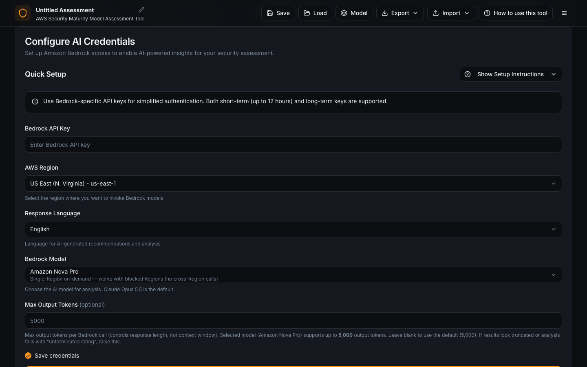

分析の結果は `Results` タブの Highlights（よくできている点）、Common Themes（共通する課題）、Toxic Combinations（組み合わさると危険な不備）に追加できます。たとえば「MFA が未対応」と「アクセスキーが長期間使われている」のように、単独では中程度でも組み合わさると危険な不備を洗い出すのに使えそうです。

### 結果を確認してエクスポートする

ここではツールに付いている `Generate Sample Data` でランダムな整合度を入れて画面を確認しました。以降の画面の数値はサンプルデータで、実際の環境の評価結果ではありません。

画面の上部には全体の整合度、評価の完了率、フェーズで重み付けしたリスクスコア、フェーズごとの進捗が表示されます。

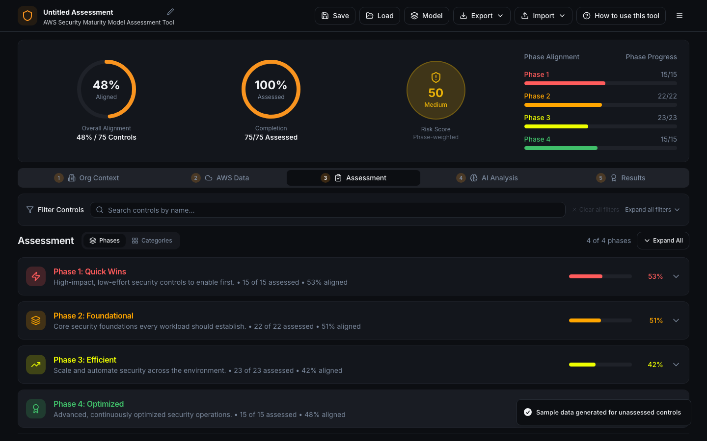

`Results` タブの `Alignment Map` ではマトリクスの形でコントロールごとの整合度を一覧できます。

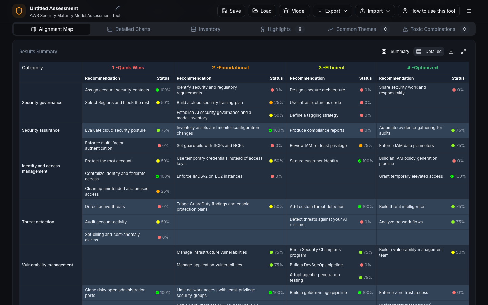

`Detailed Charts` では、フェーズ別とセキュリティ領域別の整合度がグラフで表示されます。

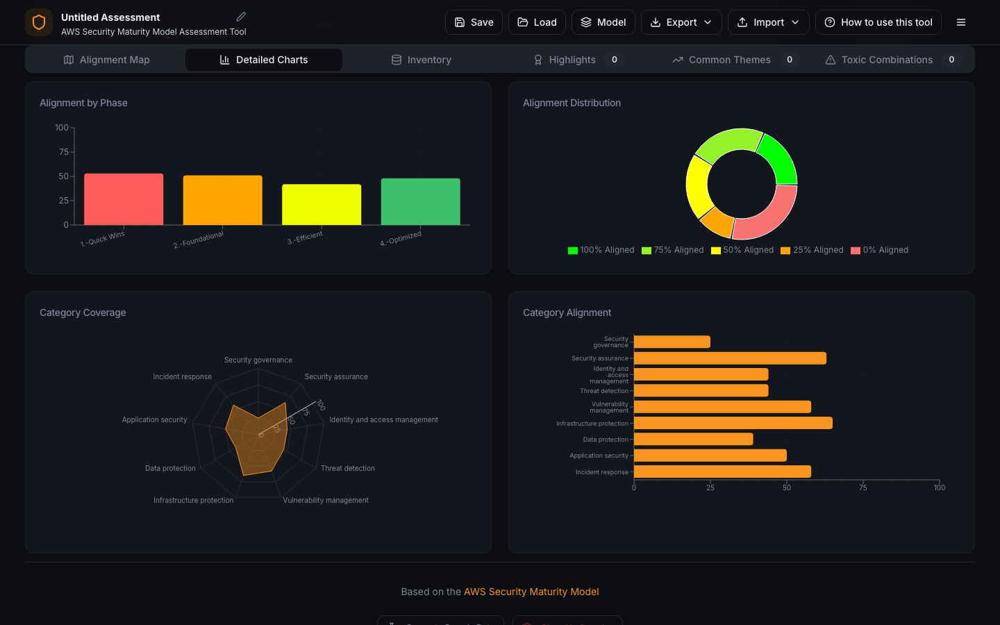

評価結果は JSON、Excel、PowerPoint、Word、PDF でエクスポートできます。PowerPoint には「Recommended」と表示されていて、評価結果をそのまま報告資料として共有する使い方を想定しているようです。ブラウザのデータを消すと評価も消えるので、作業の区切りごとに JSON でエクスポートしておくと安心です。

### 認証情報の扱いに注意する

評価ツールに認証情報を入力する前に、保存の設定を確認しておく必要があります。

:::message alert
SMM Signal の記事によると、AWS の認証情報を保存するオプションはソースコード上で既定で有効になっています。有効なままだと、アクセスキー、シークレットキー、セッショントークンがブラウザのローカルストレージに保存されます。筆者が確認したときは、`AI Analysis` タブの `Save credentials`（Bedrock の API キーの保存）も既定でチェックが入っていました。

記事では次の対策が案内されています。

- 保存する理由がなければ、保存のチェックを外す
- 長期のアクセスキーではなく、有効期限のある一時的な認証情報を使う
- 読み取り専用の最小権限で使う。単一アカウントでは AWS 管理ポリシーの `SecurityAudit` が推奨されている
- Bedrock の API キーは必要なモデルへのアクセスに絞り、作業が終わったら無効にする
- 共有のコンピューターでは使わない
:::

### PCI DSS 版と AI 版のサイトにある自己評価ページ

PCI DSS 版と AI 版のサイトには評価ツールとは別に、簡易的な自己評価のページもあります。

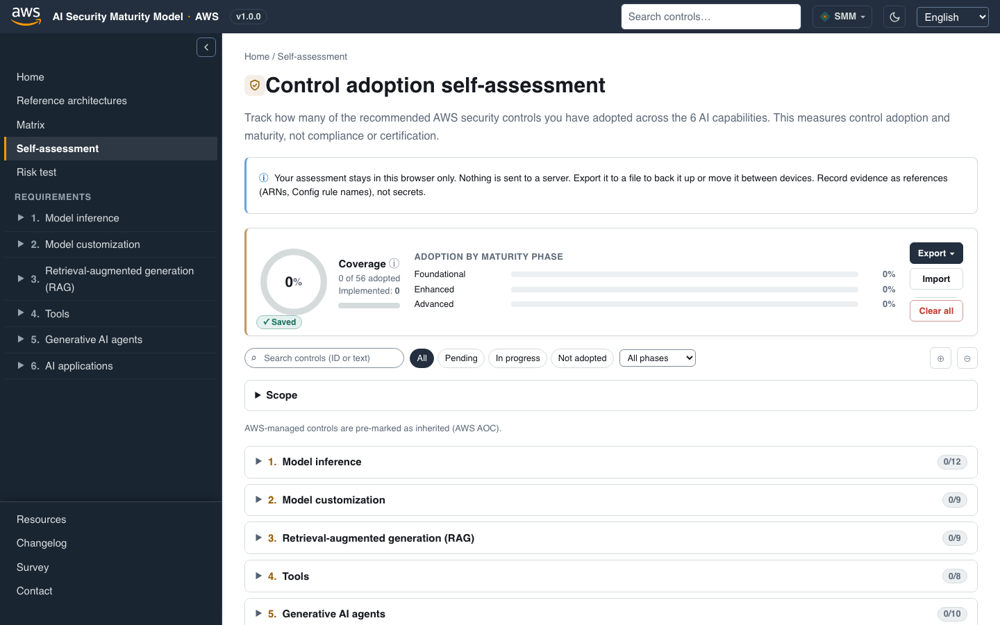

こちらはコントロールごとに状況（未着手、進行中、実装済み、該当なし、リスク受容）とエビデンスを記録するシンプルなものです。結果は JSON のほか、OSCAL の assessment-results 形式や、改善計画の CSV でもエクスポートできます。どちらのページでも、エビデンスには ARN や Config ルール名などの参照を書き、シークレットは書かないよう注意書きがあります。

## モデルの使い分け

3 つのエディションは置き換えではなく、組み合わせて使うものです。筆者は次のように使い分けるのがよいと考えています。

| 状況 | 使うモデル |
| --- | --- |
| AWS を使っているすべての組織 | Cloud 版をベースにする |
| AWS 上にカード会員データ環境（CDE）がある | Cloud 版に加えて PCI DSS 版で CDE を評価する |
| 生成 AI やエージェントのワークロードがある | Cloud 版に加えて AI 版で評価し、ユースケースごとに Risk test を実施する |

Cloud 版にも AI ガバナンス（c2.3）や AI ランタイムの脅威検知（c3.8）、生成 AI のデータ保護（c2.14）が入っていますが、どれも組織全体として最低限押さえる内容です。Bedrock や AgentCore を使ってワークロードを作っているなら、AI 版でケイパビリティごとに詳しく確認したほうが漏れを減らせます。

## まとめ

AWS セキュリティ成熟度モデルの v3 と、新しく登場した PCI DSS 版・AI 版、そして評価ツールを確認しました。

Cloud 版は項目数こそ 74 から 75 とほぼ変わりませんが、AI やエージェントに関するコントロールが加わり、各コントロールに検証方法やフレームワークとの対応が書かれるようになりました。v2 で評価を進めていた場合も、評価ツールでは v2 のモデルを選べるので、まずは v2 で評価を続けながら、上で紹介した差分を見て v3 への切り替え時期を決めるとよさそうです。

評価ツールは Excel 時代に比べて、AWS からのデータ収集や Prowler の結果の取り込み、PowerPoint へのエクスポートまで 1 つのツールでできるようになっています。認証情報の保存設定にだけ注意して、セキュリティ運用の現状を把握し、次の一手を決めるのに活用してみてください。

この記事がどなたかの役に立つと嬉しいです。
