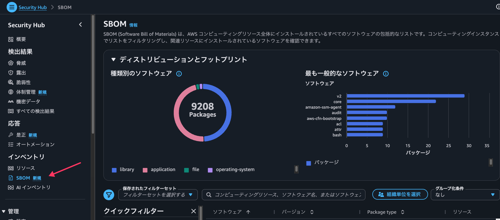
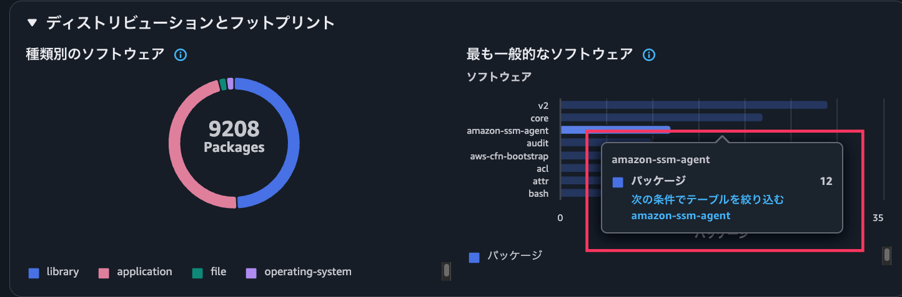
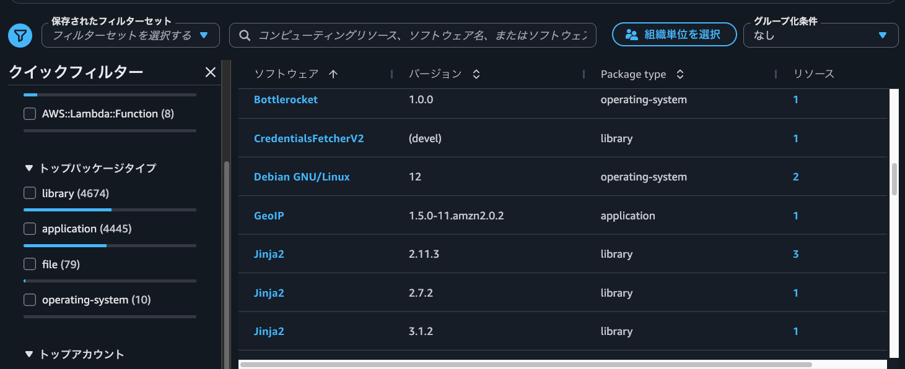
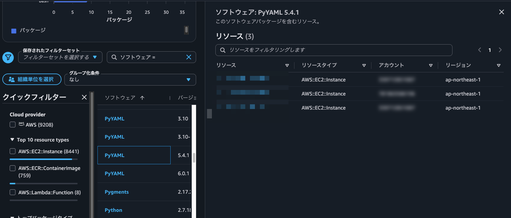
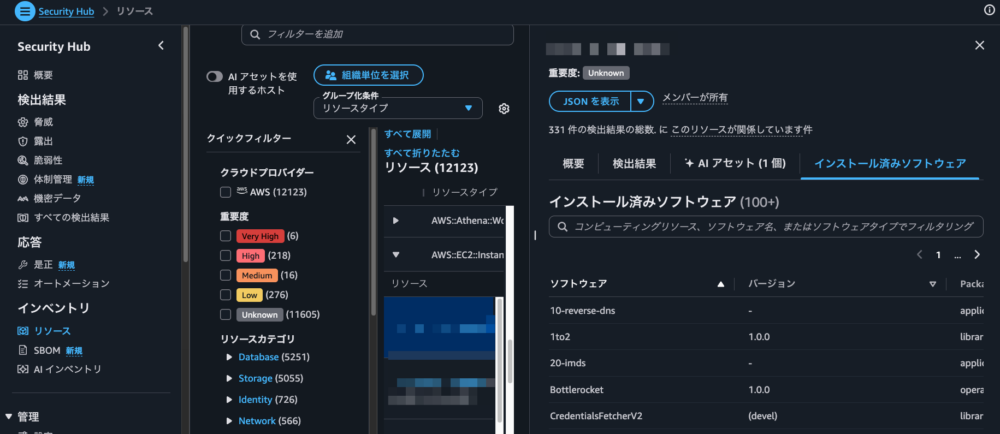

こんにちは、CSC の [CloudFastener](https://cloud-fastener.com/) というプロダクトで TAM のポジションで働いている平木です！

先日、Amazon Inspector の SBOM を S3 にエクスポートし、Athena で組織横断の影響調査をする記事を書きました。

https://zenn.dev/cscloud_blog/articles/inspector-sbom-php-research

この方法は柔軟に調べられる一方で、S3 バケットや KMS キー、Athena のテーブルを用意する必要があり、エクスポートし直すたびにテーブルも作り直す手間がありました。 

そんな中、Security Hub のコンソールを見ているとインベントリの欄に SBOM が追加されていました。  
どうやら Inspector が生成した SBOM を Security Hub が組織全体で集約し、コンソールからパッケージやリソースを検索できる機能のようです。

https://docs.aws.amazon.com/securityhub/latest/userguide/securityhub-v2-sbom.html

今回は SBOM インベントリの画面を実際に触ってみて、前回の Athena を使った方法と比べてどこが楽になるのか、どんなときに Athena が必要なのかを整理します。

:::message
この記事の5行まとめ
- Security Hub と Inspector が有効なら、追加の設定なしで組織全体の SBOM をコンソールから検索できる
- S3 へのエクスポートや Athena のテーブル作成が不要で、リソースの追加や削除にも自動で追従する
- パッケージから導入先のリソースを探し、そのまま検出結果やインストール済みソフトウェアを確認できる
- `GetSoftwareV2` API などで取得でき（AWS CLI は 2.39.4 以降）、CSV への一括出力もできる
- 細かい条件での検索、CVE とパッケージの突き合わせ、ある時点の記録が必要なときは、引き続き Athena での分析が役に立つ
:::

## Athena と Security Hub の比較

まずは前回の Athena を使った方法と Security Hub の SBOM インベントリの違いを表にまとめておきます。

| 観点 | Inspector の SBOM エクスポート + Athena | Security Hub の SBOM インベントリ |
| --- | --- | --- |
| 事前準備 | S3 バケット、KMS キー、各ポリシー、Athena のワークグループとテーブル | 不要（Security Hub と Inspector を有効にするだけ） |
| データの鮮度 | エクスポートした時点のスナップショット | Inspector のスキャンに合わせて自動更新（反映まで数時間かかる場合あり） |
| 削除したリソース | エクスポートし直すまで残る | 自動でインベントリから削除される |
| 調べ方 | SQL | コンソールのフィルターとグループ化、API |
| 検索条件の柔軟さ | 正規表現、purl の種類、CVE との突き合わせなど自由に書ける | パッケージ、バージョン、パッケージタイプ、アカウント、リージョン、リソースタイプ、クラウドプロバイダーで絞り込み（API ではリソース ID なども指定できる） |
| 脆弱性との関係 | SBOM 内の CVE 情報をクエリで扱える | リソースの詳細画面から検出結果を確認 |
| 対象のクラウド | AWS | AWS と、Security Hub に接続した Azure |
| 結果の出力 | クエリ結果を CSV でダウンロード、`UNLOAD` で S3 に出力 | `GetSoftwareV2` API などで取得して CSV などに加工 |

「まず組織のどこに何が入っているかを知りたい」という場面では、Security Hub だけで済むことが多くなりそうです。

## SBOM インベントリとは

さて、ここからは SBOM インベントリの仕組みと前提条件を見ていきます。

### 仕組み

大まかには、Inspector が生成した SBOM を Security Hub が受け取り、リソースごとに最新の SBOM を保持する仕組みです。

Inspector はスキャンしたリソースのパッケージ一覧を SBOM として生成し、Security Hub に送ります。Security Hub はリソースごとに最新の SBOM だけを保持します。リソースが終了・削除された場合や Inspector のスキャン対象から外れた場合は、そのリソースのソフトウェアをインベントリから削除します。定期的に Inspector との突き合わせも行われるので、両者の情報はずれないようになっています。

前回の記事ではエクスポートのたびに `<reportId>` の違うフォルダに出力されるため、テーブルを作り直す必要がありました。SBOM インベントリは Inspector のスキャン結果に自動で追従するので、この作業はなくなります。

:::message
Inspector が新しい SBOM を生成してから、SBOM インベントリに反映されるまで数時間かかる場合があります。パッケージを入れた直後のリソースは、すぐには表示されないことがあります。
:::

### 対象のリソース

SBOM インベントリは、Inspector がスキャンするコンピューティングリソースを対象にしています。

| 種類 | 例 |
| --- | --- |
| 仮想マシン | Amazon EC2 インスタンス、Azure の仮想マシン |
| コンテナイメージ | Amazon ECR のコンテナイメージ、Azure Container Registry のコンテナイメージ |
| サーバーレス関数 | AWS Lambda 関数 |

Security Hub に Azure を接続している場合は、Azure のリソースも同じ画面で確認できます。

### 前提条件

SBOM インベントリを使うために、Security Hub 側で追加の設定は必要ありません。次の条件を満たしていれば、自動でデータが入ります。

- 対象のアカウントとリージョンで Security Hub が有効になっている
- インベントリに含めたいリソースタイプ（EC2、ECR、Lambda など）で Inspector のスキャンが有効になっている

Inspector がスキャンしていないリソースタイプのソフトウェアは表示されません。たとえば Inspector で EC2 だけをスキャンしている場合、インベントリには EC2 のソフトウェアだけが含まれます。

委任管理者アカウントは組織内の有効なアカウントすべてのソフトウェアを、メンバーアカウントは自分のアカウントのリソースのソフトウェアだけを確認できます。

## SBOM 画面を見てみる

それでは、検証環境の Security Hub の委任管理者アカウントで実際に SBOM の画面を開いてみます。

Security Hub のコンソールを開き、左メニューの「インベントリ」から「SBOM」を選びます。



### グラフで全体像をつかむ

画面上部の「ディストリビューションとフットプリント」には、インベントリ全体を要約した 2 つのグラフが表示されます。

| グラフ | 内容 |
| --- | --- |
| 「種類別のソフトウェア」 | パッケージタイプごとのインストール数の内訳。中央にインストール数の合計 |
| 「最も一般的なソフトウェア」 | 最も多くのリソースにインストールされているパッケージ |

グラフの値を選ぶと、下のパッケージ表がその値で絞り込まれます。



### パッケージ表

グラフの下にはパッケージ表があり、パッケージとバージョンの組み合わせごとに 1 行で表示されます。

| 列 | 内容 |
| --- | --- |
| 「ソフトウェア」 | パッケージ名 |
| 「バージョン」 | バージョン |
| 「Package type」 | パッケージタイプ |
| 「リソース」 | そのパッケージがインストールされているリソースの数 |

同じパッケージが複数のリソースに入っていても表では 1 行で、どれだけ広く使われているかは「リソース」の数でわかります。一方でグラフはリソースごとにインストール数を数えるので、グラフの合計は表の行数より大きくなります。たとえば `openssl 3.1.4` が 3 つのリソースに入っている場合、表では 1 行、グラフでは 3 インストールです。



## パッケージからリソースを探す

続けて、新しい脆弱性が公表されたときに「そのパッケージがどこに入っているか」を調べてみます。

パッケージ表でソフトウェア名か「リソース」の数を選ぶと、そのパッケージを含むリソースの一覧がパネルに表示されます。一覧にはリソースごとにリソースタイプ、アカウント、リージョンが並びます。



一覧からリソースを選ぶと、リソースの詳細パネルが開きます。詳細パネルではリソースの重要度、そのリソースの検出結果、インストールされているソフトウェアすべてを確認できます。

前回の Athena での分析では、Inspector の検出結果やリソースの重要度を見るには別の画面や API に移る必要がありました。Security Hub ではパッケージ → リソース → 検出結果を同じコンソールの中で行き来できます。

## リソースからインストール済みソフトウェアを見る

今度は逆に、特定のリソースに何がインストールされているかを確認することもできます。

Security Hub の「リソース」画面、または検出結果からコンピューティングリソースを開き、「インストール済みソフトウェア」タブを選びます。そのリソースにインストールされているパッケージがバージョンとパッケージタイプ付きで一覧表示され、パッケージ名で絞り込むこともできます。



検出結果をトリアージするときに「このリソースは何をしているサーバーなのか」をソフトウェアの構成から推測できるので、地味に便利です。

## API で SBOM インベントリを取得する

画面で見るだけでなく、結果を CSV にしてチケットに添付したいこともあると思います。記事を書き始めた時点の AWS CLI（2.38.6）では SBOM インベントリ用の API を呼び出せませんでしたが、2.39.4 に更新すると次の 3 つの API が使えるようになっていました。以下の例では AWS CLI から呼び出しています。

| API | 内容 |
| --- | --- |
| `GetSoftwareV2` | パッケージの一覧。パッケージ名、バージョン、パッケージタイプと、インストールされているリソースの数を返す |
| `GetSoftwareResourcesV2` | 指定したパッケージを含むリソースの一覧 |
| `GetSoftwareStatisticsV2` | 指定した項目ごとのインストール数の集計 |

どれも委任管理者アカウントで呼び出すと、組織全体のデータが対象になります。`Scopes` パラメーターを指定すれば、特定の OU に絞ることもできます。

### パッケージを検索する

まずは `GetSoftwareV2` API で、名前が `openssl` で始まるパッケージを探してみます。

```bash
aws securityhub get-software-v2 \
  --filters '{"CompositeFilters":[{"StringFilters":[{"FieldName":"PackageName","Filter":{"Value":"openssl","Comparison":"PREFIX"}}]}]}' \
  --query 'Software[].[PackageName,PackageVersion,PackageType,ResourceCount]' \
  --output text
```

```text
openssl                       1.0.2k-24.amzn2.0.16   application  1
openssl                       3.0.13-0ubuntu3.11     application  1
openssl                       3.0.19                 application  2
openssl                       3.0.20-1~deb12u2       application  1
openssl                       3.2.2-1.amzn2023.0.1   application  3
openssl-libs                  3.2.2-1.amzn2023.0.1   application  3
openssl-pkcs11                0.4.12-3.amzn2023.0.1  application  5
...
```

比較の方法は `EQUALS`、`NOT_EQUALS`、`PREFIX`、`PREFIX_NOT_EQUALS` の 4 つです。バージョンは `3.0.13-0ubuntu3.11` や `3.2.2-1.amzn2023.0.1` のように、ディストリビューションのバージョン番号まで含めて返ってきました。

フィルターには `ResourceId` も使えるので、インスタンス ID を指定すれば、そのリソースのインストール済みソフトウェアを一覧にできます。

### パッケージを含むリソースを一覧にする

続けて、`GetSoftwareResourcesV2` API でパッケージを含むリソースを一覧にします。パッケージ名とパッケージタイプは必須で、`GetSoftwareV2` API が返した値と同じものを指定します。

```bash
aws securityhub get-software-resources-v2 \
  --package-name openssl \
  --package-type application \
  --package-version 3.2.2-1.amzn2023.0.1
```

```json
{
  "SoftwareResources": [
    {
      "AccountId": "222222222222",
      "ResourceType": "AWS::EC2::Instance",
      "Region": "ap-northeast-1",
      "ResourceId": "i-0123456789abcdef0",
      "ResourceProvider": "AWS",
      "ResourceOwnerAccountId": "222222222222",
      "ResourceCloudPartition": "aws",
      "ResourceRegion": "ap-northeast-1"
    }
  ]
}
```

ECR のコンテナイメージの場合、`ResourceId` は `リポジトリ名/sha256:イメージダイジェスト` の形式でした。

:::message alert
API の説明では、`PackageVersion` を省略するとすべてのバージョンのリソースが返るとされています。しかし今回の環境では、`PackageVersion` を省略すると `"SoftwareResources": []` と空の結果が返りました。リソースを一覧にするときは、`GetSoftwareV2` API で取得したバージョンを指定して呼び出すのが確実です。
:::

### インストール数を集計する

`GetSoftwareStatisticsV2` API を使うと、画面のグラフのような集計を取得できます。たとえばリソースタイプごとのインストール数は次のとおりです。

```bash
aws securityhub get-software-statistics-v2 \
  --group-by-rules '[{"GroupByField":"ResourceType"}]' \
  --query 'GroupByResults[0].GroupByValues' \
  --output text
```

```text
8441  AWS::EC2::Instance
759   AWS::ECR::ContainerImage
8     AWS::Lambda::Function
```

この数はパッケージとリソースの組み合わせの数で、3 つのリソースに入っているパッケージは 3 と数えられます。

:::message
今回の環境では Security Hub のリージョン集約を設定していません。それでも東京リージョン（ap-northeast-1）で呼び出すと、大阪リージョン（ap-northeast-3）のリソースも結果に含まれていました。一方、大阪リージョンで呼び出した場合は、大阪リージョンのリソースだけが返りました。対象のリージョンが漏れていないかは、`Region` でグループ化して確認しておくと安心です。
:::

### CSV に出力する

最後に、2 つの API を組み合わせて、パッケージとリソースの対応を CSV に出力するスクリプトを書いてみました。

```bash:sbom_to_csv.sh
#!/usr/bin/env bash
set -euo pipefail
PACKAGE_PREFIX="${1:?usage: $0 <package-name-prefix>}"
FILTER=$(printf '{"CompositeFilters":[{"StringFilters":[{"FieldName":"PackageName","Filter":{"Value":"%s","Comparison":"PREFIX"}}]}]}' "$PACKAGE_PREFIX")

echo "package_name,package_version,package_type,account_id,region,resource_type,resource_id"
aws securityhub get-software-v2 --filters "$FILTER" \
  --query 'Software[].[PackageName,PackageVersion,PackageType]' --output text |
while IFS=$'\t' read -r name version type; do
  aws securityhub get-software-resources-v2 \
    --package-name "$name" --package-type "$type" --package-version "$version" \
    --query 'SoftwareResources[].[AccountId,Region,ResourceType,ResourceId]' --output text |
  while IFS=$'\t' read -r account region rtype rid; do
    echo "$name,$version,$type,$account,$region,$rtype,$rid"
  done
done
```

```bash
./sbom_to_csv.sh openssl > openssl.csv
```

```text:openssl.csv
package_name,package_version,package_type,account_id,region,resource_type,resource_id
openssl,1.0.2k-24.amzn2.0.16,application,222222222222,ap-northeast-1,AWS::EC2::Instance,i-0123456789abcdef0
openssl,3.0.19,application,222222222222,ap-northeast-1,AWS::ECR::ContainerImage,sample-app/sha256:0123abcd...
openssl,3.2.2-1.amzn2023.0.1,application,222222222222,ap-northeast-3,AWS::EC2::Instance,i-0fedcba9876543210
...
```

`openssl` で始まるパッケージとバージョンの組み合わせ 17 件に対して、28 行が出力されました。`GetSoftwareV2` API の `ResourceCount` の合計とも一致しています。パッケージの種類が多いと `GetSoftwareResourcesV2` API の呼び出し回数も増えるので、検索条件はなるべく絞り込んでから実行するのがおすすめです。

## Athena での分析が引き続き役に立つ場面

とはいえ、SBOM インベントリで多くの調査が楽になる一方で、前回の記事でやったことの中には Security Hub の画面だけでは難しいこともあります。ここからはそうした場面を順に見ていきます。

### 細かい条件で検索したいとき

コンソールのフィルターに使える項目は、パッケージ、バージョン、パッケージタイプ、アカウント、リージョン、リソースタイプ、クラウドプロバイダーです。

前回の記事では、`php/php`、`php8.3-cli`、`php84` のように名前の付け方が違うパッケージを、正規表現でまとめて「PHP の実行環境あり」と判定していました。また、purl の種類（`pkg:dpkg`、`pkg:rpm`、`pkg:generic`）を見て、OS のパッケージ更新で直せるのか、イメージの再ビルドが必要なのかを切り分けていました。API のフィルターでも `PREFIX` で `php` から始まるパッケージをまとめて探すことはできますが、正規表現は使えず、purl も返ってきません。こうした条件を組み合わせた分析は、SQL で自由に書ける Athena のほうが向いています。

### バージョン番号での判定

前回の記事で紹介したとおり、Ubuntu などのディストリビューションは上流の修正をバックポートするので、バージョン番号の比較だけでは修正済みかどうかを判断できません。

これは Security Hub の SBOM インベントリでも同じです。SBOM インベントリはパッケージの棚卸しに使い、脆弱性の有無は Inspector の検出結果で判断するのが確実です。対象のリソースを詳細パネルで開けば検出結果も確認できるので、「パッケージで探す → 検出結果で判定する」という流れが自然だと思います。

SBOM の中の CVE 情報を使って、「この CVE に該当するパッケージ」を一覧にするような分析をしたい場合は、Athena を使います。

### ある時点の状態を残したいとき

SBOM インベントリはリソースごとに最新の SBOM だけを保持し、削除されたリソースのソフトウェアは自動でインベントリから消えます。

監査やインシデント対応で「ある時点に何が入っていたか」を記録として残したい場合は、SBOM をエクスポートして S3 に保存しておくほうが向いています。

### Inspector の SBOM の注意点

SBOM インベントリのデータは Inspector が生成した SBOM です。そのため、前回の記事で紹介した Inspector の SBOM の注意点は、Security Hub でも同じように当てはまると考えられます。

- Inspector がスキャンしていないリソース（SSM Agent が動いていない EC2 など）は含まれない
- Lambda レイヤーに含まれる言語ランタイム本体（前回の Bref の PHP など）は SBOM に含まれなかった
- コンテナイメージで作った Lambda 関数は Lambda としてはスキャンされず、ECR 側のイメージとして確認する必要があった

「SBOM インベントリに出てこない = そのソフトウェアがない」とは限らない点は、引き続き注意が必要です。

## 使い分け

ここまでの内容をもとに、使い分けを表にまとめてみました。

| やりたいこと | おすすめ |
| --- | --- |
| 脆弱性が公表されたとき、該当パッケージが組織のどこにあるかすぐ知りたい | Security Hub |
| 特定のリソースに何が入っているかを確認したい | Security Hub |
| 検出結果のトリアージで、リソースの役割を把握したい | Security Hub |
| 名前の揺れや purl の種類など、細かい条件で分析したい | Athena |
| SBOM の CVE 情報とパッケージを突き合わせて一覧にしたい | Athena |
| パッケージとリソースの対応を CSV などで出力したい | Security Hub（API） |
| ある時点の SBOM を記録として残したい | SBOM エクスポート |

まず Security Hub で全体像と該当リソースを把握し、細かい分析や記録が必要なときだけ SBOM をエクスポートして Athena で調べる、という流れがよさそうです。

## まとめ

Security Hub の SBOM インベントリを触って、前回の Athena を使った方法と比べてみました。

- Security Hub と Inspector が有効なら、追加の設定なしで組織全体の SBOM をコンソールから検索できる
- S3、KMS、Athena のテーブルの準備や、再エクスポートのたびのテーブルの作り直しが不要になる
- パッケージ → リソース → 検出結果を同じコンソールの中で行き来できる
- `GetSoftwareV2` API などで取得でき（AWS CLI は 2.39.4 以降）、CSV への一括出力もできる
- 細かい条件での分析、CVE とパッケージの突き合わせ、ある時点の記録には、引き続き SBOM エクスポートと Athena が役立つ

前回の記事を書いたときは、SBOM を活用するには Athena の準備が前提でした。Security Hub の SBOM インベントリによって、「どこに何が入っているか」を調べる最初の一歩がかなり手軽になったと感じます。Inspector と Security Hub を有効にしている環境であれば、すでにデータは入っているはずなので、ぜひ一度画面を開いてみてください。

この記事がどなたかの役に立つと嬉しいです。
