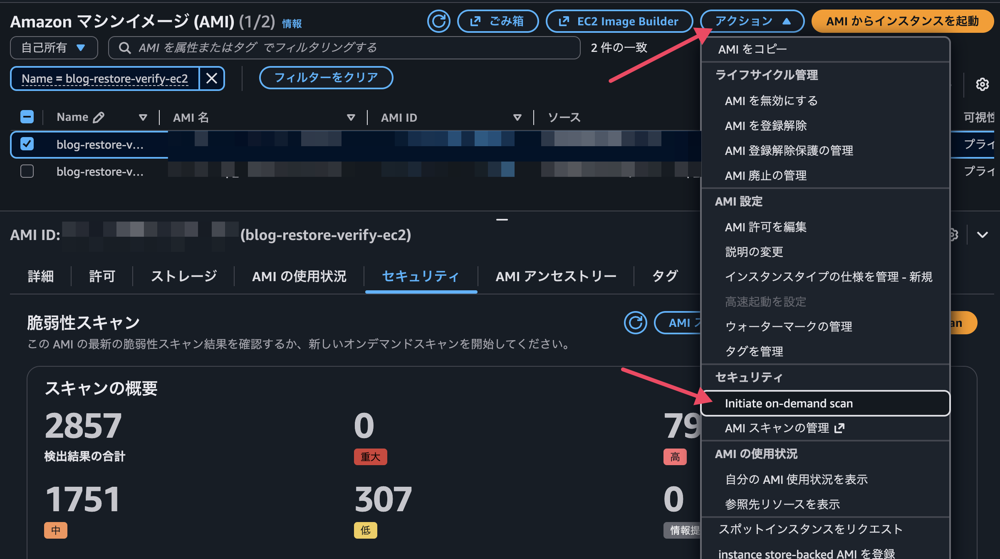
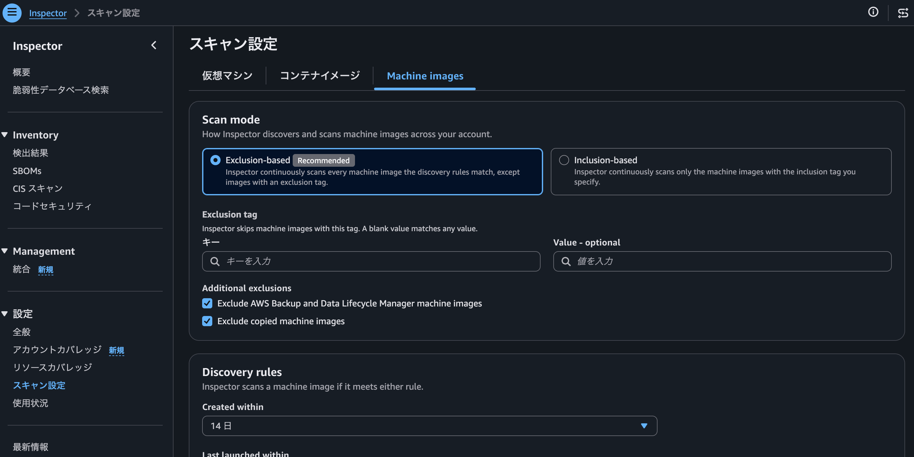
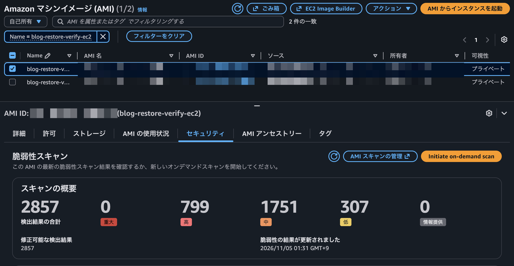
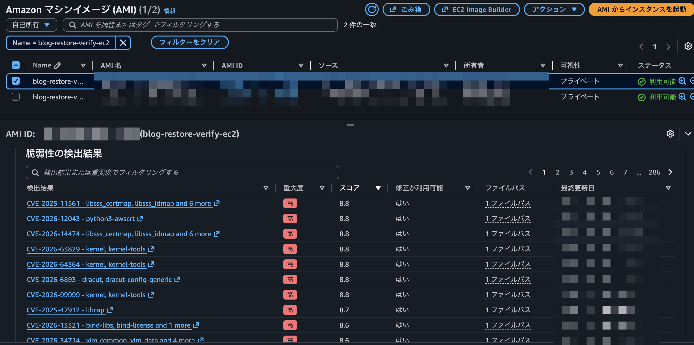
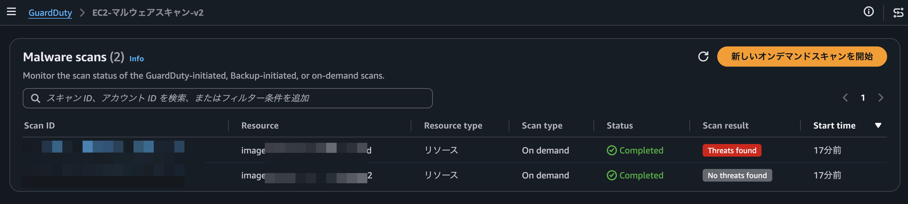
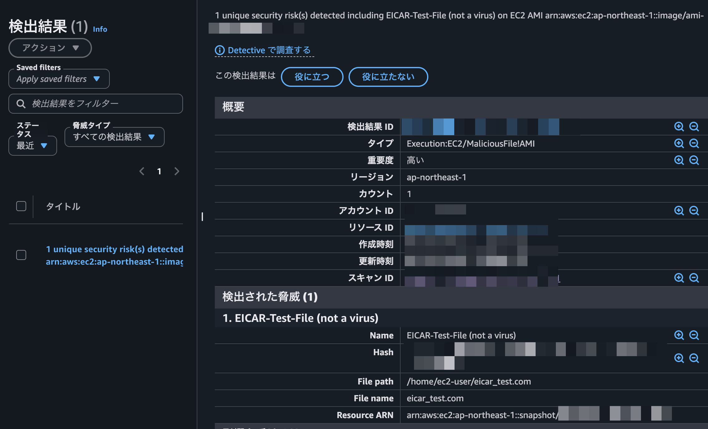
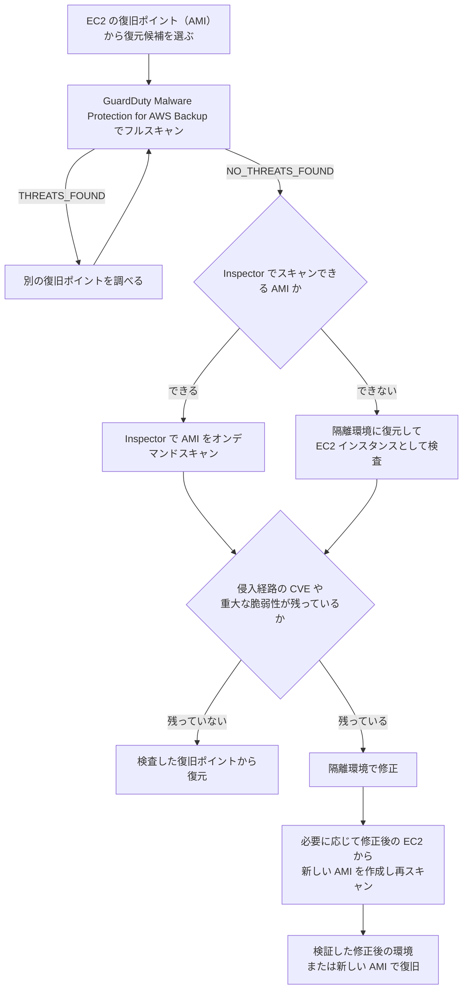

こんにちは、CSC の [CloudFastener](https://cloud-fastener.com/) というプロダクトで TAM のポジションで働いている平木です！

2026 年 11 月に Amazon Inspector で EC2 の AMI を脆弱性スキャンできるようになり、オンデマンドスキャンにも対応しました。

https://aws.amazon.com/about-aws/whats-new/2026/11/ec2-amis-scanned-through-inspector/

https://dev.classmethod.jp/articles/inspector-ami-scan-al2023-update/

一方、Amazon GuardDuty にも Malware Protection for AWS Backup があり、AWS Backup の復旧ポイントや AMI をオンデマンドでスキャンできます。どちらも「AMI をスキャンする」機能ですが、見ているものはまったく違います。

この記事では 2 つの機能の違いを整理したうえで、ランサムウェア被害などのインシデントから復旧するときに「戻すバックアップが本当に安全か」をどう検証するかを考えます。

:::message
**この記事の 4 行まとめ**

- Inspector の AMI スキャンは「既知の脆弱性（CVE）が残っていないか」、GuardDuty Malware Protection for AWS Backup は「マルウェアが潜んでいないか」を見る機能です。置き換えではなく組み合わせて使います
- EC2 の復旧ポイント（AMI）から戻す場合は、GuardDuty でマルウェアが検出されなかった復旧ポイントに候補を絞り込み、Inspector で再侵入の入口になる脆弱性が残っていないかを確認します
- Inspector の継続スキャンは AWS Backup が作成した AMI をデフォルトで対象外にするため、復旧時はオンデマンドスキャンを使います
- どちらのスキャン結果も安全性を保証するものではないため、復元してよいかを判断する材料の一つとして使います
:::

## 2 つの機能の比較

まずは 2 つの機能の違いを表にまとめます。

| 観点 | Inspector の AMI スキャン | GuardDuty Malware Protection for AWS Backup |
| --- | --- | --- |
| 検出するもの | OS・プログラミング言語パッケージの既知の脆弱性（CVE） | ファイルに含まれるマルウェア |
| 仕組み | AMI を構成する EBS スナップショットからソフトウェアインベントリを作り、脆弱性データと照合 | 復旧ポイントのデータを読み取り、複数のスキャンエンジンで検査 |
| 対象リソース | 自アカウントが所有する EBS-backed AMI（AWS Backup の EC2 復旧ポイントを含む） | EBS スナップショット、AMI、AWS Backup の復旧ポイント（EC2 / EBS / S3） |
| スキャンの種類 | 継続スキャン / オンデマンドスキャン | バックアッププランでの自動スキャン / オンデマンドスキャン（それぞれフルまたは増分） |
| サービスの有効化 | オンデマンドスキャンは Inspector の有効化不要 | GuardDuty を有効化していなくても利用可能 |
| 結果の確認先 | オンデマンドスキャンは EventBridge と EC2 コンソールのみ | EventBridge、GuardDuty コンソール、AWS Backup コンソール。GuardDuty 有効時は Finding としても出力 |
| 料金体系 | 成功したスキャン 1 回ごと | スキャンしたデータ量（GB）ごと |

## なぜバックアップを検証してから戻すのか

ランサムウェア被害を受けたとき、多くの組織は「暗号化される前のバックアップから戻せば復旧できる」と考えます。しかし、攻撃者は暗号化を実行する前から環境内に潜伏している場合があり、その間に取得されたバックアップには次のようなものが含まれている可能性があります。

- 攻撃者が設置したマルウェアやバックドア
- 初期侵入に悪用された脆弱性が残ったままの OS やミドルウェア

前者が含まれたバックアップを戻せば、攻撃者の足場をそのまま復元することになります。後者が残っていれば、マルウェアが含まれていなくても同じ手口で再び侵入される可能性があります。

つまり、復元に使うバックアップが「安全」であるためには、少なくとも次の 2 つを満たしている必要があります。

1. マルウェアが含まれていないこと
2. 侵入の入口になる脆弱性が残っていないこと（残っているなら、本番に戻す前に修正すること）

1 を調べるのが GuardDuty Malware Protection for AWS Backup、2 を調べるのが Inspector の AMI スキャンです。

## インシデント対応プロセスの中での位置づけ

インシデント対応は一般に「検知・分析」「封じ込め」「根絶」「復旧」といったフェーズで進みます。この記事で扱うのは、このうち **復旧フェーズで、どのバックアップから戻すかを決めて実際に戻すまで** の部分です。

侵害範囲の調査や原因の特定は、前のフェーズで行われている前提です。

## Inspector の AMI スキャン

### 仕組みと 2 つのスキャン方式

Inspector の AMI スキャンは、AMI を構成する EBS スナップショットからソフトウェアインベントリを収集し、50 を超えるデータフィードから集めた脆弱性データと照合します。スナップショットを直接読み取るため、AMI からインスタンスを起動する必要はありません。

これまでも、AMI から起動した EC2 インスタンスを Inspector の EC2 スキャンで検査したり、EC2 Image Builder のパイプラインでテスト用インスタンスをスキャンしたりする方法はありました。AMI スキャンでは AMI そのものをスキャンできるため、復元候補のバックアップを確認するためだけにインスタンスを起動する必要がなくなります。ただし、後述するように、所有者や OS、ファイルシステム、暗号化の条件を満たす AMI に限られます。

https://docs.aws.amazon.com/imagebuilder/latest/userguide/integ-inspector.html

なお、AWS Backup で EC2 インスタンスをバックアップすると、復旧ポイントは EBS-backed AMI として保存されます。そのため、EC2 の復旧ポイントは Inspector の AMI スキャンの対象にできます。

https://docs.aws.amazon.com/aws-backup/latest/devguide/working-with-supported-services.html

スキャン方式は 2 つあります。

| 観点 | 継続スキャン | オンデマンドスキャン |
| --- | --- | --- |
| 開始のきっかけ | AMI の作成・コピー・登録時と、関連する新しい CVE の追加時に自動でスキャン | `StartOnDemandScan` API または EC2 コンソールから AMI を指定して実行 |
| Inspector の有効化 | 必要 | 不要 |
| スキャン設定（対象期間・タグ・除外設定） | 適用される | 無視される |
| 再スキャン | 自動 | なし（再度実行する） |
| 結果の出力先 | Inspector コンソール、Security Hub など通常の Finding と同じ | EventBridge のみ（EC2 コンソールの AMI 詳細でも確認可能） |
| 無料トライアル | 対象 | 対象外 |

https://docs.aws.amazon.com/inspector/latest/user/scanning-machine-images.html

https://docs.aws.amazon.com/inspector/latest/user/machine-image-on-demand.html

### 復旧用途で使うときの注意点

**継続スキャンはバックアップの AMI をデフォルトで除外する**

継続スキャンには「コピーされた AMI」と「バックアップの AMI」を除外する設定があり、どちらもデフォルトで有効です。バックアップの AMI は、AWS Backup や Amazon Data Lifecycle Manager が付与する `aws:backup:source-resource` または `aws:dlm:lifecycle-policy-id` タグで判定されます。

そのため、Inspector の継続スキャンを有効にしていても、AWS Backup で取得した EC2 の復旧ポイント（AMI）はスキャンされていない可能性があります。オンデマンドスキャンはこの除外設定を無視するので、復旧時に特定の復旧ポイントを確認したい場合はオンデマンドスキャンが向いています。

https://docs.aws.amazon.com/inspector/latest/user/machine-image-scan-configuration.html

**結果は Inspector コンソールにも Security Hub にも出ない**

オンデマンドスキャンの結果は EventBridge にのみ配信され、Inspector コンソール、`ListFindings` API、Security Hub CSPM には表示されません。コンソールで確認する場合は EC2 コンソールの AMI の「セキュリティ」タブを使います。

筆者の検証では、2025 年 1 月版の Amazon Linux 2023 の AMI から起動した EC2 インスタンスを AWS Backup でバックアップしました。その復旧ポイント（AMI）をオンデマンドスキャンしたところ、2,857 件の脆弱性が検出されました。

https://docs.aws.amazon.com/AWSEC2/latest/UserGuide/ami-scanning.html

復旧作業で結果を記録・共有したい場合は、`Inspector2 OnDemand Scan Complete` と `Inspector2 OnDemand Finding` のイベントを受け取る EventBridge ルールを事前に用意しておくと便利です。なお、スキャンの記録は完了から 30 日で参照できなくなります。

**スキャンできるのは自アカウントが所有する AMI だけ**

スキャン対象は、AMI とそれを構成するスナップショットの両方を自アカウントが所有しているものに限られます。共有された AMI はコピーしてからスキャンする必要があります。

:::message
logically air-gapped vault の復旧ポイントは、AWS Backup が所有するサービスアカウントに保管されます（[AWS Storage Blog](https://aws.amazon.com/blogs/storage/aws-backup-2025-year-in-review-advancing-recovery-resilience/)）。ARN も元の `arn:aws:ec2:region::image/ami-*` ではなく `arn:aws:backup:region:account-id:recovery-point:*` の形式になります（[AWS Backup ドキュメント](https://docs.aws.amazon.com/aws-backup/latest/devguide/logicallyairgappedvault.html)）。自アカウントが所有する AMI ではないため、Inspector のオンデマンドスキャンの条件を満たしません。

Inspector で検査したい場合は、標準のバックアップボールトにある EC2 の復旧ポイントを使います。logically air-gapped vault から標準のバックアップボールトへコピーするには、コピーをカスタマー管理キーで暗号化する必要があります。また、コピーできるのはボールトを所有するアカウントだけです。コピーできない場合は、隔離した環境に復元した EC2 インスタンスを [Inspector の EC2 スキャン](https://docs.aws.amazon.com/inspector/latest/user/scanning-ec2.html)で検査します。
:::

また、AMI が KMS キーで暗号化されている場合、キーポリシーで Inspector の読み取りが許可されていないと `ACCESS_DENIED` で失敗します。

**対応していない AMI がある**

ファイルシステムは `ext3`、`ext4`、`ntfs`、`xfs` に対応しています。LVM を使っている AMI はスキャンできず、`UNSUPPORTED_OS` になります。また、複数の OS を含む AMI もスキャンの対象外です。

**料金はスキャン 1 回ごと**

オンデマンドスキャンは成功したスキャン 1 回ごとに課金され、同じ AMI を再スキャンした場合も別途課金されます。執筆時点では東京リージョンで 1 回あたり 0.51 USD、バージニア北部リージョンで 0.42 USD です。最新の料金は料金ページで確認してください。

https://aws.amazon.com/inspector/pricing/

## GuardDuty Malware Protection for AWS Backup

### 仕組みと 2 つのスキャン方式

GuardDuty Malware Protection for AWS Backup は、バックアップに含まれるファイルを読み取り、複数のスキャンエンジンでマルウェアを検査します。対象は EBS スナップショット、AMI、AWS Backup の復旧ポイント（EC2 / EBS / S3）です。GuardDuty 本体（検出器）を有効にしていなくても利用できます。

使い方は 2 つあります。

- バックアッププランでの自動スキャン: バックアップの完了後に自動でスキャンします。平常時の運用向けです
- オンデマンドスキャン: GuardDuty コンソールや `StartMalwareScan` API、AWS Backup から既存の復旧ポイントを指定してスキャンします。復旧時に使うのは主にこちらです

それぞれフルスキャンと増分スキャンを選べます。増分スキャンは 2 つの復旧ポイントの差分だけを検査するため、安く速く済みます。

https://docs.aws.amazon.com/guardduty/latest/ug/malware-protection-backup-how-it-works.html

https://docs.aws.amazon.com/aws-backup/latest/devguide/malware-protection.html

### マルウェア検査による復元候補の絞り込み

AWS Backup のドキュメントでは、過去の復旧ポイントにオンデマンドスキャンをかけて、復元に使うバックアップを探す使い方が推奨されています。複数のバックアップを隔離環境に順番に復元して調べなくても、復旧ポイントのままスキャンできるのが大きな利点です。

https://aws.amazon.com/blogs/storage/scan-backups-for-malware-with-amazon-guardduty-malware-protection-for-aws-backup/

スキャン結果は `THREATS_FOUND` または `NO_THREATS_FOUND` で返ってきます。`NO_THREATS_FOUND` は「マルウェアが検出されなかった」という意味で、マルウェアが存在しないことを保証するものではありません。`THREATS_FOUND` だった場合は、別の復旧ポイント（たとえば、より古いもの）を同じようにスキャンして、復元候補を絞り込みます。

GuardDuty を有効にしている場合は、`THREATS_FOUND` になった AMI について Finding も生成されます。筆者の検証では、EICAR テストファイルを置いた EC2 インスタンスから AWS Backup で取得した AMI をスキャンしたところ、`Execution:EC2/MaliciousFile!AMI` タイプの Finding が出力され、脅威名とファイルパスを確認できました。

:::message
復元前のスキャンは **フルスキャン** で行うことが推奨されています。増分スキャンは差分しか見ないため、過去のスキャン時点ではシグネチャがなく検出できなかったマルウェアが、変更のないファイルに残っている可能性があるからです。
:::

S3 の継続的バックアップ（PITR）については、`GetPITRMalwareScanResults` API や AWS Backup コンソールで、指定した時点のスキャン結果を確認できます。スキャンしていない時点を指定した場合の結果は unknown になります。

### 注意点

- AWS Backup で確認できるのはスキャン結果の集約だけです。検出されたファイル名やパスなどの詳細は、GuardDuty を有効にしている場合に GuardDuty の Finding として確認します。GuardDuty を有効にしていない場合は Finding が生成されず、EventBridge でスキャン結果を受け取ることになります
- スキャンの状態が `COMPLETED_WITH_ISSUES` のときは、全部を検査できていません。ボリュームのサイズや数、S3 オブジェクトのサイズや種類の制限により、一部がスキャンされなかったことを示します。「脅威なし」と判断する前に、何がスキップされたかを GuardDuty 側で確認してください
- logically air-gapped vault 内の EC2 復旧ポイントと、コピーされた EC2 復旧ポイントは、増分スキャンに対応していません。フルスキャンを使います
- 同時実行数には上限があり、アカウントあたり 150、リソースタイプあたり 5 の同時スキャンまでです。多くの復旧ポイントを一度にスキャンしようとすると待ちが発生します
- 料金はスキャンしたデータ量に比例し、執筆時点ではバージニア北部リージョンで 1 GB あたり 0.05 USD です。復旧時のフルスキャンを繰り返すとデータ量に応じて費用がかかる点は把握しておきましょう

https://aws.amazon.com/guardduty/pricing/

### Malware Protection for EC2 のオンデマンドスキャンとの違い

GuardDuty には稼働中の EC2 インスタンスの ARN を指定する Malware Protection for EC2 のオンデマンドスキャンもあります。こちらはインスタンスにアタッチされた EBS ボリュームのスナップショットをその場で作成してスキャンする機能で、「今動いているインスタンスが感染していないか」を調べるものです。

戻す前にバックアップを検証する用途では、既存の復旧ポイントや AMI を直接指定できる Malware Protection for AWS Backup を使います。

https://docs.aws.amazon.com/guardduty/latest/ug/malware-protection.html

## 2 つの機能の組み合わせ方

ここでは、AWS Backup で取得した EC2 の復旧ポイント（AMI）から復旧するケースを例にします。EBS スナップショットや S3 の復旧ポイントは GuardDuty Malware Protection for AWS Backup で検査できますが、Inspector の AMI スキャンの対象ではありません。

GuardDuty でマルウェアが検出されなくても、脆弱性が残っていないとは限りません。逆に Inspector で CVE が見つからなくても、マルウェアが含まれていないとは言えません。両方の結果を合わせて、次の流れで判断します。

Inspector の結果で特に注目したいのは、初期侵入に悪用された脆弱性です。前のフェーズの調査で侵入経路の CVE がわかっていれば、その CVE が残っているかどうかを最優先で確認します。Finding には `fixAvailable` や `exploitAvailable` も含まれるので、修正の可否や悪用コードの有無も判断材料になります。

脆弱性が残っている場合は、スキャンした AMI をそのまま本番に戻すのではなく、隔離した環境に復元してパッチを適用します。このとき、復元した EC2 インスタンスにパッチを適用しても、元の復旧ポイント（AMI）は更新されません。本番に戻すのは、修正した環境そのものか、修正後の EC2 インスタンスから作成した新しい AMI です。新しい AMI を作成した場合は、Inspector で再スキャンして修正を確認してから使います。

## スキャンだけではカバーできない範囲

:::message alert
2 つのスキャンで「問題なし」となっても、復元に使うバックアップが完全に安全だと保証されるわけではありません。

- シグネチャのない未知のマルウェアは検出できない可能性があります
- Inspector はパッケージの脆弱性、GuardDuty はマルウェアを検出する機能です。`authorized_keys` への公開鍵の追加や cron の設定のような、マルウェアではない設定の改ざんは、どちらの検出対象にも含まれていません
- Inspector が見るのはパッケージの既知の脆弱性で、ミドルウェアの設定不備やアプリケーション固有の脆弱性は対象外です

スキャン結果は「復元してよいか」を判断する材料の一つとして扱い、侵入経路の調査結果と合わせて判断してください。
:::

## まとめ

Inspector の AMI スキャンと GuardDuty Malware Protection for AWS Backup は、どちらも AMI を対象にできます。ただし、前者は脆弱性、後者はマルウェアを見る機能です。

ランサムウェア被害から EC2 を復旧する場合は、GuardDuty でマルウェアが検出されなかった復旧ポイントに候補を絞り込み、Inspector で侵入の入口になる脆弱性が残っていないかを確認してから戻す、という組み合わせが有効です。脆弱性が残っていれば、隔離した環境で修正し、その環境か、修正後に作成した AMI を使って復旧します。

なお、こうした検証は、復元に使うバックアップが残っていることが前提です。バックアップ自体を削除や改ざんから守る仕組みも、あわせて用意しておきましょう。

Inspector の AMI スキャンは登場したばかりの機能で、AWS Backup の AMI がデフォルトで継続スキャンの対象外になっているなど、復旧用途で使うには知っておきたい仕様もあります。いざというときに慌てないよう、平常時に一度試しておくことをおすすめします。

この記事がどなたかの役に立つと嬉しいです。
